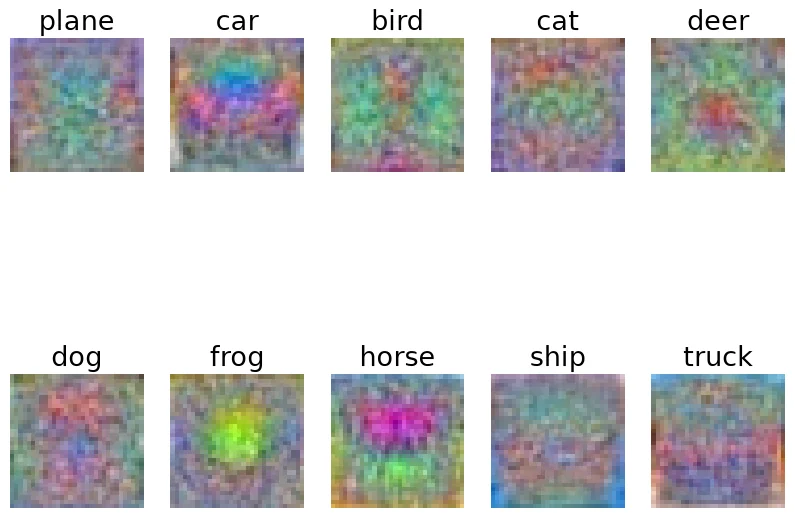
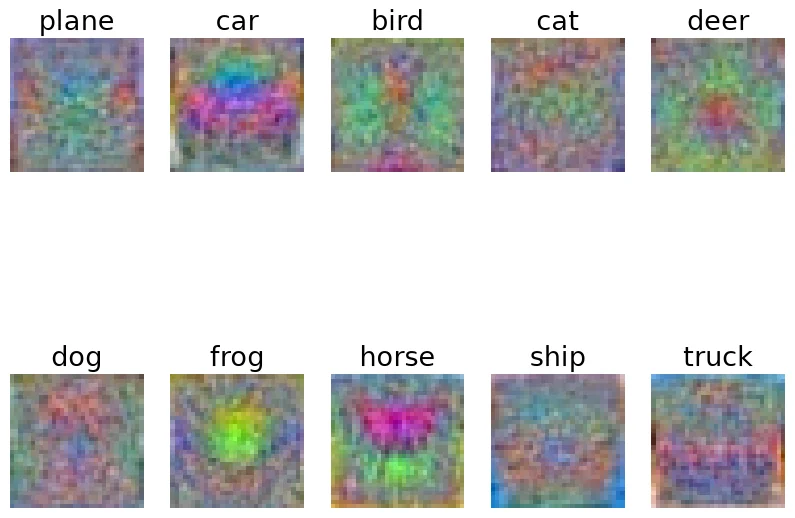
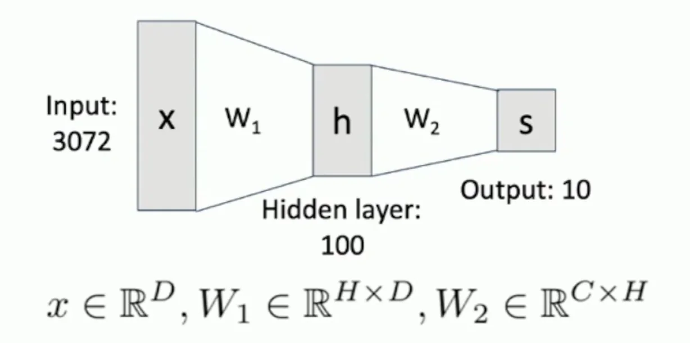
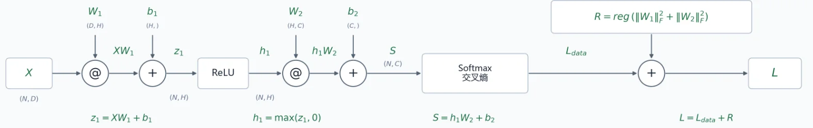
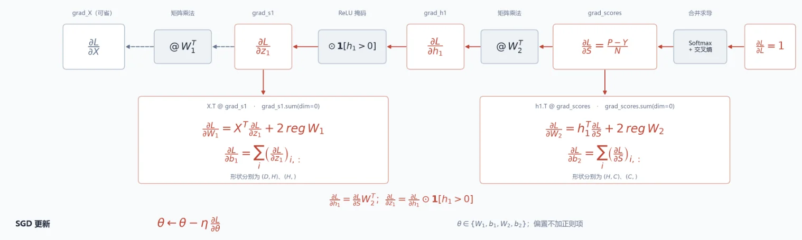
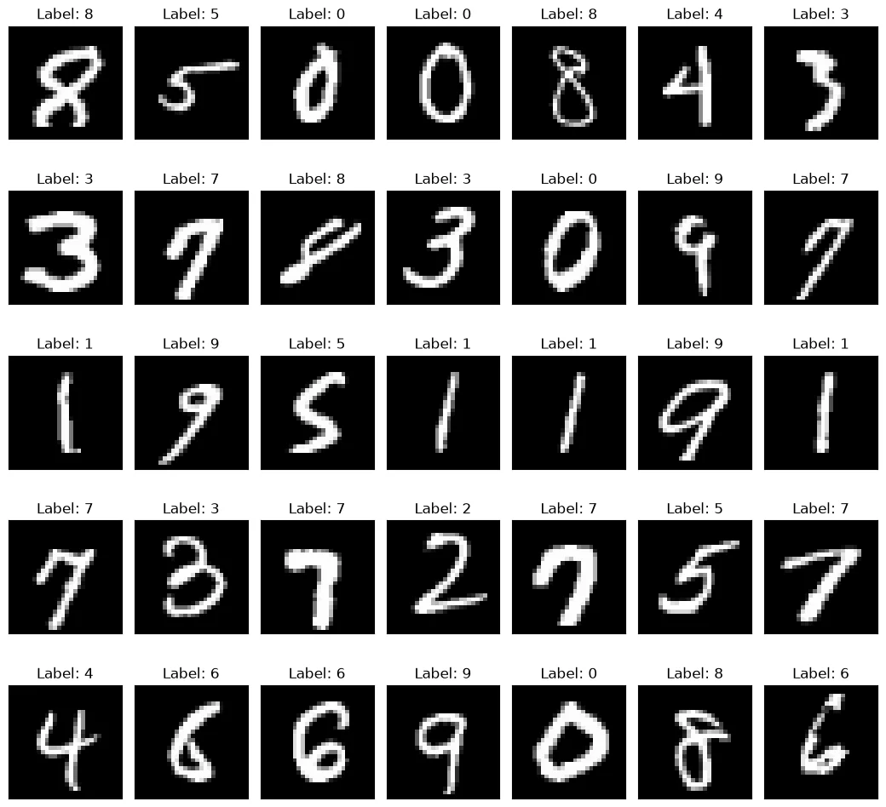
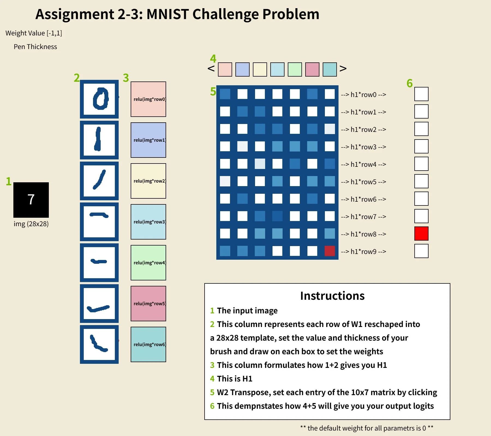
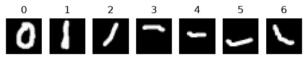
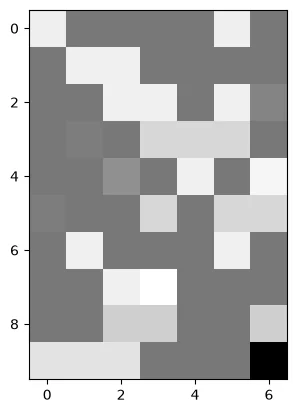

# Assignment 2：Linear Classifier & Two-layer Neural Network

A2 include 3 questions:

**Q1: Linear Classifiers**. Walk you through implmenting SVM and Softmax classifier.

**Q2: Two-layer Neural Network**. Walk you through implementing a two-layer neural network-based classifier.

**Q3: MNIST Challenge**. Walk you through the challenge problem where you will manually set the weights of a Two-layer Neural Network classifier and evaluate on MNIST hand drawn digits. This interesting notebook encourages you to rely on your intuition to achieve the desired results.

---

## Linear Classifier

线性分类器通过一层权重矩阵来给图片在各个类别打分：

$$\mathbf{s} = f(\mathbf{x},W) = W\mathbf{x} + \mathbf{b}$$

$$\text{（实际训练中 W 要转置）}$$

其中$W$为需要训练的权重矩阵，形如(`num_classes`，`D`)，$\mathbf{b}$ 为偏置。$\mathbf{x}$为输入的图片向量（各参数向量拼接成一个(`D`,)的大向量），$y$ 为 $\mathbf{x}$ 的实际类别。$\mathbf{s}$是得分向量，给出 $\mathbf{x}$ 在每一类别的得分。可以通过把 $\mathbf{b}$ 接到 $W$ 的最后一列、并在 $\mathbf{x}$ 的末尾补一个 1 （同时维度+ 1）来隐藏偏置。在本次线性分类器的训练中，我们采用了这种方法。

在这一章节，我们需要实现两种线性分类器，它们采用不同的损失函数来衡量预测得分与期望的差距。为了减少过拟合的影响，我们在损失函数后添加正则化项。

$$ L(W) = \frac{1}{N} \Sigma_i L_i(x_i,y_i,W) + \lambda R(W) $$

然后，通过求损失函数对权重矩阵的偏导来计算梯度 $\nabla W$。

$$ \nabla_W L(W) = \frac{1}{N} \Sigma_i \nabla_W L_i(x_i,y_i,W) + \lambda \nabla R(W) $$

这里$R(W)$ 取 $\Sigma_i \Sigma_j W_{i,j}^2$，即矩阵 $W$ 的 $F$ 范数的平方。

最后，在每一轮的优化步骤中，我们采用简单的随机梯度下降(Stochastic Gradient Descent)(SGD)。

$$ W_{t+1} = W_{t} - \alpha \nabla_W $$

其中 $\alpha$ 是学习率。

???+ quote "Hyperparameters"

    线性分类器涉及的主要的两个超参数是正则化系数 $\lambda$ 和学习率 $\alpha$ ，它们的选择对训练效果的影响较大。

### SVM Classifier

- 损失函数：$L_i = \Sigma_{j \neq y_i}\max(0,s_j - s_{y_i} +1)$
- 梯度：$\nabla_W L_i = \Sigma_{s_j - s_{y_i} + 1 > 0}^{j \neq y_i} (\nabla_W s_j - \nabla_W s_{y_i})$

其中 $\mathbf{d}W\text{[ j ]} = \nabla_W s_j = \mathbf{x}$

👉 最终梯度还需除以训练图片数目，然后加上正则化项的梯度。

#### SVM Loss & Gradient

**svm_loss_naive**

使用循环的方法来计算损失函数和梯度

```py linenums="1"
def svm_loss_naive(
    W: torch.Tensor, X: torch.Tensor, y: torch.Tensor, reg: float
):

    dW = torch.zeros_like(W)  # initialize the gradient as zero

    # compute the loss and the gradient
    num_classes = W.shape[1]
    num_train = X.shape[0]
    loss = 0.0
    for i in range(num_train):
        scores = W.t().mv(X[i])
        correct_class_score = scores[y[i]]
        for j in range(num_classes):
            if j == y[i]:
                continue
            margin = scores[j] - correct_class_score + 1  # note delta = 1
            if margin > 0:
                loss += margin

                dW[:,j] += X[i]
                dW[:,y[i]] -= X[i]

    # Right now the loss is a sum over all training examples, but we want it
    # to be an average instead so we divide by num_train.
    loss /= num_train

    # Add regularization to the loss.
    loss += reg * torch.sum(W * W)

    dW /= num_train
    dW += 2*reg*W

    return loss, dW
```

在每次的内循环中累加`score`涉及到的每个权重对总梯度的贡献，循环外将梯度矩阵除以常数`num_train`并加上正则化项的导数。

**svm_loss_vectorized**

**计算 loss**

计算工程中使用广播，并通过布朗矩阵`mask`判断需要累加的`margin`项。

```py linenums="1" title="v0" hl_lines="6"
num_classes=W.shape[1]
num_train=X.shape[0]
scores=torch.mm(W.t(),X.t())
correct_class_scores=scores[y,range(num_train)]

scores[y,range(num_train)]-=1
margin=scores-correct_class_scores+1
mask=(margin>0)

loss+=margin[mask].sum()
loss /= num_train
loss+=reg*torch.sum(W*W)
```

然而在实际计算中，会有一个问题。高亮行通过把正确类别的分数减 1 来抵消 `margin` 运算中对正确类别项额外加的 1 ，但在浮点运算中，由于精度问题，最终可能得到一个很小的接近 0 的数，它依旧会被`mask`判定为`True`。

```py linenums="1" title="v1"
margin=scores-correct_class_scores+1
mask=(margin>0)
mask[y,range(num_train)]=False
```

对`v0`的 6-8 行进行修改，显式更改正确类别在`mask`中的布朗值，避免了浮点运算精度的影响。

**计算梯度**

一开始，我希望延续循环版本计算梯度的逻辑，只是把每次内循环对权重贡献的累加通过广播向量化。利用`mask`矩阵正确项的行列索引，得知需要计算梯度的`score`在`scores`矩阵的位置，然后把它们对相应权重的导数加到`dW`的相应位置上。另外，对于正确类别分数计算梯度，还需要得知损失函数里`margin`符合条件的次数。

```py linenums="1" title="v0" hl_lines="4-5"
row,column=torch.where(mask)
count=mask.sum(dim=0)

dW[:,row]+=X[column,:].t()
dW[:,y]-=count*X[range(num_train),:].t()

dW /= num_train
dW+=2*reg*W
```

然而，高亮行存在一些问题。因为作为索引`row`和`y`会有重复值，按这种切片赋值时，解释器不会顺着我的想法，按重复下标累计，而会报错。

为了解决这个问题，我尝试使用`scatter_add_`进行累加，将高亮行改为如下形式：

```py linenums="1" title="v1" hl_lines="1-2 5-6"
index1=torch.zeros(D,row.shape[0],device="cuda",dtype=int)
index2=torch.zeros(D,y.shape[0],device="cuda",dtype=int)
index1+=row
index2+=y
dW.scatter_add_(1,index1,X[column,:].t())
dW.scatter_add_(1,index2,-count*X[range(num_train),:].t())
```

它的逻辑和`v0`语法错误的部分是相同的，只是用`index`矩阵绕了一圈，换成一种合法的实现。

这种实现通过了正确性测试，但性能方面不是很好，相比循环版本只有约 `20X` 加速。这是由于我构建了两个很大的索引矩阵`index1/2`，并且在`scatter_add_`中多次拷贝大矩阵`X`的整行，又向`dW`中做了多次累加，开销较大。

经 AI 提示，梯度的计算其实可以换一种角度思考。除了从`score`出发，找所有对它有贡献的权重然后计算梯度，我们还可以从 $W_{ij}$ 出发，找到所有它贡献过的`score`，把它贡献的所有梯度累加到 $\mathbf{d} W_{ij}$ 中。

这个逻辑可以用矩阵乘法表示，`torch`很擅长矩阵乘法，可以大大提高性能。

```py linenums="1" title="v2"
A=torch.zeros(num_classes,num_train,device=X.device,dtype=X.dtype)
A[mask]=1.0
A[y,range(num_train)]=-count.to(dtype=float)
dW+=torch.mm(X.t(),A.t())
```

构造一个(C,N)的系数矩阵$\mathbf{A}$，它与`scores`矩阵具有相同的结构。将它的`margin>0`的非正确项赋值为 1 ，正确类别项赋值为 `-count`。

$\mathbf{d} W = \mathbf{X^T} \mathbf{A^T}$ 实际上就是在对每个权重一次性累加它对所有相关分数的梯度贡献。

`v2`相对`svm_loss_naive`的加速比为`155.38X`。

#### SVM Train

首先补全一些通用的训练和预测相关的函数，**`SVM`和`Softmax`两种线性分类器公用**。

- 划分`batch`。因为一次性计算训练集所有的损失/梯度并求平均开销很大，我们在训练集中采样，每次仅用`batch_size`个样本来计算梯度。

```py linenums="1"
def sample_batch(
    X: torch.Tensor, y: torch.Tensor, num_train: int, batch_size: int
):
    X_batch = None
    y_batch = None

    index=torch.randint(num_train,(batch_size,),device=X.device)
    X_batch=X[index,:]
    y_batch=y[index]

    return X_batch, y_batch
```

- 训练分类器，记录循环次数和`loss`的历史值。

```py linenums="1"
def train_linear_classifier(
    loss_func: Callable, W: torch.Tensor, X: torch.Tensor, y: torch.Tensor, learning_rate: float = 1e-3, reg: float = 1e-5, num_iters: int = 100， batch_size: int = 200, verbose: bool = False,
):

    # assume y takes values 0...K-1 where K is number of classes
    num_train, dim = X.shape
    if W is None:
        # lazily initialize W
        num_classes = torch.max(y) + 1
        W = 0.000001 * torch.randn(
            dim, num_classes, device=X.device, dtype=X.dtype
        )
    else:
        num_classes = W.shape[1]

    # Run stochastic gradient descent to optimize W
    loss_history = []
    for it in range(num_iters):
        # TODO: implement sample_batch function
        X_batch, y_batch = sample_batch(X, y, num_train, batch_size)

        # evaluate loss and gradient
        loss, grad = loss_func(W, X_batch, y_batch, reg)
        loss_history.append(loss.item())

        W-=learning_rate*grad

        if verbose and it % 100 == 0:
            print("iteration %d / %d: loss %f" % (it, num_iters, loss))

    return W, loss_history
```

- 使用最终的权重矩阵 $W$，计算输入图片的得分，并返回得分最高的类别。

```py linenums="1"
def predict_linear_classifier(W: torch.Tensor, X: torch.Tensor):
    y_pred = torch.zeros(X.shape[0], dtype=torch.int64)

    y_pred=torch.mm(W.t(),X.t()).argmax(dim=0)

    return y_pred
```

- 检查超参数的选取，分别在训练集和验证集运行，比较准确率。

```py linenums="1"
def test_one_param_set(
    cls: LinearClassifier,
    data_dict: Dict[str, torch.Tensor],
    lr: float,
    reg: float,
    num_iters: int = 2000,
):
    train_acc = 0.0  # The accuracy is simply the fraction of data points
    val_acc = 0.0  # that are correctly classified.

    cls.train(data_dict['X_train'],data_dict['y_train'],lr,reg,num_iters)
    y_pred_train=cls.predict(data_dict['X_train'])
    y_pred_valid=cls.predict(data_dict['X_val'])
    train_acc=(y_pred_train==data_dict['y_train']).sum().item() / data_dict['y_train'].shape[0]
    val_acc=(y_pred_valid==data_dict['y_val']).sum().item() / data_dict['y_val'].shape[0]

    return cls, train_acc, val_acc
```

???+ note "关于超参数的选取"

    对于`learning_rates`和`regularization_strengths`要如何取值能够最大化准确率，并没有一个确定的规律。我们需要先设置一些可能的超参数，并通过`test_one_param_set`进行测试，找出最好的超参数。

    一种比较好的思路是，先尝试一些跨度较大的参数，确定最优参数的大概范围，然后逐步缩小参数间的跨度和范围，提高选取的精度。

**最终结果**

- 最佳参数：
```python
learning_rates = [1e-2]
regularization_strengths = [4.92e-5]
```
- 在测试集上的准确率：38.6%
- 结果向量可视化：



### Softmax Classifier

- 损失函数：$L_i = - \log{\frac{e^{s_{y_i}}}{\Sigma_j e^{s_j}}} = - s_{y_i} + \log(\Sigma_j e^{s_j})$
- 梯度：$\nabla_W L_i = -\nabla_W s_{y_i} + \frac{\Sigma_j \nabla_W e^{s_j}}{\Sigma_j e^{s_j}}$

分类&步求梯度：

- $s_i$ 对梯度的贡献：$\frac{e^{s_i} \times \nabla_W s_i}{\Sigma_j e^{s_j}}$
- $s_{y_i}$ 对梯度的贡献：$-1 \times \nabla_W s_{y_i} +\frac{e^{s_{y_i}} \times \nabla_W s_{y_i}}{\Sigma_j e^{s_j}}$
- $\mathbf{d}W[j] = \nabla_{W} s_j = x$

分别累加到 $\mathbf{d} W$ 即可。

👉 最终梯度还需除以训练图片数目，然后加上正则化项的梯度。

#### Softmax Loss & Gradient

**softmax_loss_naive**

使用循环来计算`Softmax`的`loss`和梯度，按照上面的公式逐项求解即可。

```py linenums="1" title="v0" hl_lines="8 10-11"
num_train=X.shape[0]
num_classes=W.shape[1]
for i in range(num_train):
    scores=torch.mv(W.t(),X[i])
    correct_class_score=scores[y[i]]
    denominator=0
    for j in range(num_classes):
        denominator+=torch.exp(scores[j]).item()
    for j in range(num_classes):
        dW[:,j]+=scores[j].exp().item() * X[i] / denominator
    loss-=torch.log((torch.exp(correct_class_score) / denominator)).item()
    dW[:,y[i]]-=X[i]
loss/=num_train
loss+=reg*torch.sum(W*W)
dW /= num_train
dW += 2*reg*W
```

但这里存在一个数据存储的问题，这几行高亮代码直接对原始的分数矩阵取了指数，遇到大正数可能溢出为 `inf`，大负数可能下溢为 `0`，求的概率可能变成 `inf/inf` 或 `0/0`，非法。

实际上遇到的主要是大正数的问题。

调整方向是，每个样本先减去它的最大类别分数，再求指数，既可以减小`score`的数值，还保持了`Softmax`概率不变（分子分母都可以提出 $e_{{s_j}_{max}}$）。

除此之外，还可以考虑将损失函数的计算从 $L_i = - \log{\frac{e^{s_{y_i}}}{\Sigma_j e^{s_j}}}$ 改写为这个等价形式 $L_i = - s_{y_i} + \log(\Sigma_j e^{s_j})$ ，这样就避免了实际概率的计算。

```py linenums="1" title="v1" hl_lines="5 12"
num_train=X.shape[0]
num_classes=W.shape[1]
for i in range(num_train):
    scores=torch.mv(W.t(),X[i])
    scores-=torch.max(scores).item()
    correct_class_score=scores[y[i]]
    denominator=torch.zeros(1,device=X.device,dtype=X.dtype)
    for j in range(num_classes):
        denominator+=torch.exp(scores[j])
    for j in range(num_classes):
        dW[:,j]+=scores[j].exp().item() * X[i] / denominator
    loss+=torch.log(denominator).item()-scores[y[i]]
    dW[:,y[i]]-=X[i]
loss/=num_train
loss+=reg*torch.sum(W*W)
dW /= num_train
dW += 2*reg*W
```

这两个修改都在代码块中用高亮标出了。

**softmax_loss_vectorized**

仿照`svm_loss_vectorized`，直接用矩阵乘法表示梯度计算。

```py
num_train=X.shape[0]
num_classes=W.shape[1]
scores=torch.mm(W.t(),X.t())
scores -= torch.max(scores,dim=0).values
prob=scores.exp()
loss = loss + prob.sum(dim=0).log().sum().item() - scores[y,range(num_train)].sum().item()
loss /= num_train
loss += reg*torch.sum(W*W)

A=prob / (prob.sum(dim=0))
A[y,range(num_train)]-=1
dW = torch.mm(X.t(),A.t())
dW /= num_train
dW += 2*reg*W
```

与`svm`不同的是，`softmax`的 $\mathbf{A}$ 矩阵的非正确类项赋值为 $\frac{e^{s_i}}{\Sigma_j e^{s_j}}$（忽略`score`减去最大值的调整），正确类项在此基础上还要多减一个 1（参考前面的`softmax`梯度计算公式）。后续 $\mathbf{X^T} \mathbf{A^T}$ 将每个权重 $W_{ij}$ 的所有梯度贡献累加到 $\mathbf{d} W$。

#### Softmax Train

复用之前的训练函数，先在训练集和验证集上选择超参数，再在测试集上进行测试。

**最终结果**

- 最佳参数：

```python
learning_rates = [1e-1]
regularization_strengths = [1e-7]
```

- 在测试集上的准确率：40.01%
- 结果向量可视化：


## Two-layer Neural Network

为了解决线性分类器不能划分非线性分布（如**异或**）的问题，我们在线性分类器的前面引入一个隐藏层，构成双层神经网络（Two-layer Neural Network），并在隐藏层后使用激活函数（A2中使用的是ReLU函数）来非线性化（否则，两个网络层的权重矩阵依次相乘可看作是一个矩阵，仍然是线性分类器）。



$$\mathbf{h} = \max(0,W_1 \mathbf{X} + b_1)$$

$$\mathbf{s} = \max(0,W_2 \mathbf{h} + b_2)$$

接下来，我们需要优化这个神经网络。如果我们仍然像对待线性分类器那样，一层层手算`loss`和梯度，那会费很多草稿纸和脑细胞。一种聪明的做法是，我们把这个相对复杂的计算拆成相对简单的一个个基础运算，每个运算作为一个节点。通过前向/反向传播，每个节点把自己本地的计算结果与前面/后面节点传过来的数据结合起来，并继续传给后面/前面的节点。这样，损失函数和梯度就能顺着网络一层层计算下来。

本次实验中，使用的损失函数是`Softmax`。

???+ tip "Optimiaztion"

    **前向传播**

    

    根据损失函数的公式，从输入开始向后一层层计算`loss`。

    **反向传播**

    

    利用链式法则，从`loss`开始向前传播偏导数。每个计算节点先算出节点内的偏导数，再乘上从后面传过来的偏导数。

    🤔（A×B）矩阵 M 对（A×C） N矩阵的偏导数是一个形如（（A×B）×（A×C））的矩阵。但在实际代码中，我们不必计算这个庞大的矩阵。在神经网络中涉及到这个计算节点的只有矩阵乘法 $N \mathbf{X} = M$ （ X 为（C×B）），对 $N$ 的每项求梯度，我们发现 $\frac{\partial L}{\partial N} = \frac{\partial L}{\partial M} \mathbf{X}^T$。（为了便于记忆，我们只需比对传播过来的 $M$ 的梯度矩阵和另外的作为乘子的矩阵 $X$ 的形状，经过转置与乘法拼成所求梯度矩阵的形状即可。）

    👉 最后 $W_1$ 和$W_2$ 的梯度别忘了加上正则化项的梯度。

### Forward Pass

**计算分数**

只是在线性分类器的基础上，加了一层隐藏层。

```py linenums="1" title="nn_forward_pass"
def nn_forward_pass(params: Dict[str, torch.Tensor], X: torch.Tensor):

    W1, b1 = params["W1"], params["b1"]
    W2, b2 = params["W2"], params["b2"]
    N, D = X.shape

    hidden = None
    scores = None

    hidden=torch.mm(X,W1)+b1
    mask=(hidden<0)
    hidden[mask]=0
    scores=torch.mm(hidden,W2)+b2

    return scores, hidden
```

**计算 loss**

相比线性分类器，正则化项变成`W1`和`W2`的 F 范数的平方之和。

```py linenums="1" title="nn_forward_backward"
loss=0
max=scores.max(dim=1)[0].reshape(N,1)
prob=scores-max
loss=-scores[range(N),y].sum()
loss+=prob.exp().sum(dim=1).log().sum()
loss/=N
loss+=reg*((W1*W1).sum()+(W2*W2).sum())
```

### Backward Pass

根据传播图，从后往前传播梯度。前向和反向的过程其实都是可以用`pytorch`自动化进行的，但这里为了练习，我们手动计算。

```py linenums="1" title="nn_forward_backward" hl_lines="8 14"
grad_L=1
grad_s2=grad_L/N
grad_scores=torch.zeros(scores.shape,dtype=scores.dtype,device=scores.device)
grad_scores[range(N),y]-=1
grad_scores+=prob.exp() / prob.exp().sum(dim=1).reshape(N,1)
grad_scores*=grad_s2
grad_b2=grad_scores.sum(dim=0)
grad_W2=torch.mm(h1.t(),grad_scores)+2*reg*W2
grad_h1=torch.mm(grad_scores,W2.t())
mask=(h1==0)
grad_s1=grad_h1
grad_s1[mask]=0
grad_b1=grad_s1.sum(dim=0)
grad_W1=torch.mm(X.t(),grad_s1)+2*reg*W1
grad_X=torch.mm(grad_s1,W1.t()) #可以不算
grads['W1']=grad_W1
grads['W2']=grad_W2
grads['b1']=grad_b1
grads['b2']=grad_b2
```

参考前面画出的反向传播图，整个链式法则是十分清晰的，针对不同的算子，使用不同的求导法则，并乘上损失函数对运算结果的梯度，就求出了损失函数对该操作数（矩阵）的梯度。

🐱 一开始我忘了把正则化项对权重矩阵的梯度加进去了（高亮行），不要忘记了~

### Train

补上必要的训练和预测函数。根据算出的`loss`和梯度，还是使用 SVD 来做梯度下降，优化两个权重矩阵和两个偏置。最后使用调好的参数计算分数，给出最终预测的`label`。训练集仍旧使用我们的最爱——CIFAR-10。

**Train**

```py linenums="1"
def nn_train(
    params: Dict[str, torch.Tensor],
    loss_func: Callable,
    pred_func: Callable,
    X: torch.Tensor,
    y: torch.Tensor,
    X_val: torch.Tensor,
    y_val: torch.Tensor,
    learning_rate: float = 1e-3,
    learning_rate_decay: float = 0.95,
    reg: float = 5e-6,
    num_iters: int = 100,
    batch_size: int = 200,
    verbose: bool = False,
):

    num_train = X.shape[0]
    iterations_per_epoch = max(num_train // batch_size, 1)

    # Use SGD to optimize the parameters in self.model
    loss_history = []
    train_acc_history = []
    val_acc_history = []

    for it in range(num_iters):
        X_batch, y_batch = sample_batch(X, y, num_train, batch_size)

        # Compute loss and gradients using the current minibatch
        loss, grads = loss_func(params, X_batch, y=y_batch, reg=reg)
        loss_history.append(loss.item())

        params['W1']-=learning_rate*grads['W1']
        params['b1']-=learning_rate*grads['b1']
        params['W2']-=learning_rate*grads['W2']
        params['b2']-=learning_rate*grads['b2']

        if verbose and it % 100 == 0:
            print("iteration %d / %d: loss %f" % (it, num_iters, loss.item()))

        # Every epoch, check train and val accuracy and decay learning rate.
        if it % iterations_per_epoch == 0:
            # Check accuracy
            y_train_pred = pred_func(params, loss_func, X_batch)
            train_acc = (y_train_pred == y_batch).float().mean().item()
            y_val_pred = pred_func(params, loss_func, X_val)
            val_acc = (y_val_pred == y_val).float().mean().item()
            train_acc_history.append(train_acc)
            val_acc_history.append(val_acc)

            # Decay learning rate
            learning_rate *= learning_rate_decay

    return {
        "loss_history": loss_history,
        "train_acc_history": train_acc_history,
        "val_acc_history": val_acc_history,
    }
```

**Predict**

```py linenums="1" title="v0" hl_lines="7-11"
def nn_predict(
    params: Dict[str, torch.Tensor], loss_func: Callable, X: torch.Tensor
):

    y_pred = None

    hidden=torch.mm(X,params['W1'])+params['b1']
    mask=(hidden<=0)
    hidden[mask]=0
    scores=torch.mm(hidden,params['W2'])+params['b2']
    y_pred=scores.argmax(dim=1)

    return y_pred
```

这里有个小技巧，可以直接复用损失函数来计算`score`，不用再手写一遍。

```py linenums="1" title="v1" hl_lines="7"
def nn_predict(
    params: Dict[str, torch.Tensor], loss_func: Callable, X: torch.Tensor
):

    y_pred = None

    y_pred=loss_func(params,X).argmax(dim=1)

    return y_pred
```

这是因为在`nn_forward_backward`函数里，有一段代码：

```py linenums="1" hl_lines="8-9"
def nn_forward_backward(
    params: Dict[str, torch.Tensor],
    X: torch.Tensor,
    y: Optional[torch.Tensor] = None,
    reg: float = 0.0
):
...
if y is None:
        return scores
...
```

不传`label`向量这个参数，函数就会在计算完分数后直接返回分数。

### Hyperparameters

使用默认的超参数，训练效果依旧比较差。所以我们需要在正式训练前使用训练集和验证集调整一些超参数。

???+ note "Hyperparameters"

    本次实验涉及到的超参数有这几个，它们从不同维度影响了训练效果。

    - hidden_sizes：隐藏层维度的大小，它会影响神经网络的容量。神经网络容量越大，能存储的信息量越大，效果更好。但容量过大时，由于过拟合，性能会有所衰退。
    - regularization_strengths：正则化系数，反应正则化的强度。完全没有正则化，神经网络容易对训练集过拟合；正则化系数过大，神经网络会无法从训练集中学到有用的东西。总的来说，小比大要好。
    - learning_rates：学习率，决定每一步梯度下降的步长。
    - learning_rate_decays：学习率的衰减因子，对性能的影响没有前三个参数那么重要。
    - num_iters：迭代次数。

调参之前，我们需要补全必要的测试函数。

使用一个四重循环来测试各种超参数组合的训练准确率。

```py linenums="1"
def find_best_net(
    data_dict: Dict[str, torch.Tensor], get_param_set_fn: Callable
):

    best_net = None
    best_stat = None
    best_val_acc = 0.0

    num_iters=2801
    learning_rates,hidden_sizes,regularization_strengths,learning_rate_decays=get_param_set_fn()
    for lr in range(len(learning_rates)):
        for hs in range(len(hidden_sizes)):
            for rs in range(len(regularization_strengths)):
                for lrd in range(len(learning_rate_decays)):
                    net=TwoLayerNet(data_dict['X_train'].shape[1],hidden_sizes[hs],data_dict['y_train'].max().item()+1)
                    stat=net.train(data_dict['X_train'],data_dict['y_train'],data_dict['X_val'],data_dict['y_val'],learning_rates[lr],learning_rate_decays[lrd],regularization_strengths[rs],num_iters)
                    if stat['val_acc_history'][-1]>best_val_acc:
                        best_net=net
                        best_stat=stat
                        best_val_acc=stat['val_acc_history'][-1]
                        print(
                            f"lr={learning_rates[lr]}, hidden={hidden_sizes[hs]}, "
                            f"reg={regularization_strengths[rs]}, decay={learning_rate_decays[lrd]}, "
                            f"val={best_val_acc:.2%}"
                        )

    return best_net, best_stat, best_val_acc
```

### 最终结果

- 最佳参数：

```
learning_rates = [0.8]
hidden_sizes = [8192]
regularization_strengths = [1e-8]
learning_rate_decays = [0.8]
num_iters=2801
```

- 在测试集上的准确率：`54.84%`

## Challenge Problem

手动设计一个双层神经网络来识别 MNIST 数据集中的手写数字。



*<center style="font-size:14px;color:#C0C0C0">MNIST数据集样本展示</center>*

???+ question "问题描述"

        input (28x28 flattened) - fully connected layer (784->7) - ReLU - fully connected layer(7->10) - softmax

    输入是`28×28`像素的图片，隐藏层的维度是`7`，经过线性层最终输出 0~9 这 10 个数字的得分。

    

    这个问题场景和[`3B1B`讲神经网络结构的科普视频](https://www.bilibili.com/video/BV1bx411M7Zx/?spm_id_from=333.1387.homepage.video_card.click&vd_source=60fda5dd7dc491da53817e08aae7c717)很像，从这个视频里，也许能得到一些设计这个神经网络的启示。

### 调参

整体思路还是比较简单的。先用第一层权重矩阵找到这几个数字里一些比较有代表性的结构，例如中间竖线、圆圈、不同位置的斜线等等；然后在第二层权重矩阵里给每个数字匹配它们最相近的特征。但是实际操作起来是比较费劲的，不仅要在`W1`中结合这个训练集的数字特征，找到比较有代表性的结构及其位置，还需要在`W2`中用恰当的权重给数字匹配特征结构，过大过小都不合适，因为还需要考虑其它数字的得分。

在调权重的过程里，我的策略是先根据`MNIST`的数据，找到了几个我认为比较合适的结构，把`W1`画好；然后在`W2`里只是给每个数字最匹配/最不匹配的特征分别赋了正权重/负权重，其余先置为 0，保证各数字正负权重之和差不多。然后跑测试，让 AI 写脚本去查看每个数字的准确率，定位`W2`中不合适的权重分配，不断去调整。

### 最终结果

**神经网络设计**

过程中迭代了很多次，都记录在我的作业仓库里了，这里仅放上我最终绘制的权重图：



👉 给`W1`矩阵中正权重图案的边缘画上负权重也许能提高效果，这样可以消除一些不匹配的形状。但是由于手绘过于粗糙，很容易画歪，而且位置和形状都全凭肉眼推测，再加上这个绘图网站没办法回退，我后来就没有尝试。

**测试**

它在测试集上的准确率是`29.12 %`。

**权重矩阵可视化**



*<center style="font-size:14px;color:#C0C0C0">W1矩阵可视化</center>*



*<center style="font-size:14px;color:#C0C0C0">W2矩阵可视化</center>*