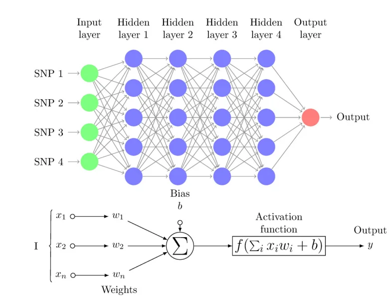
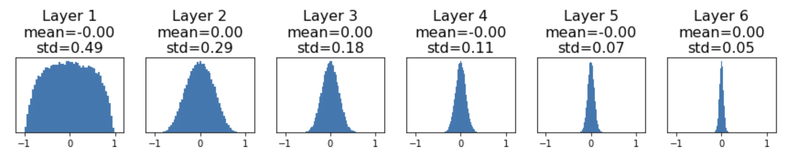
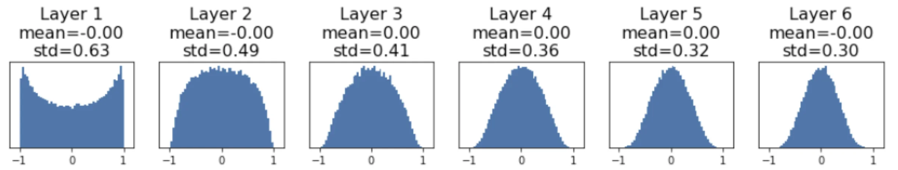
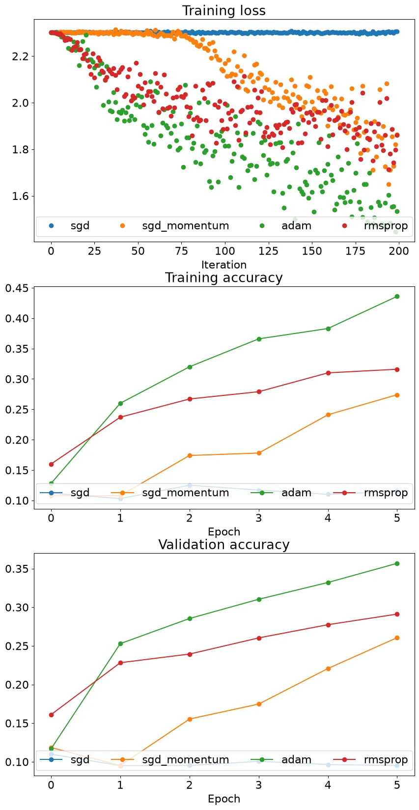
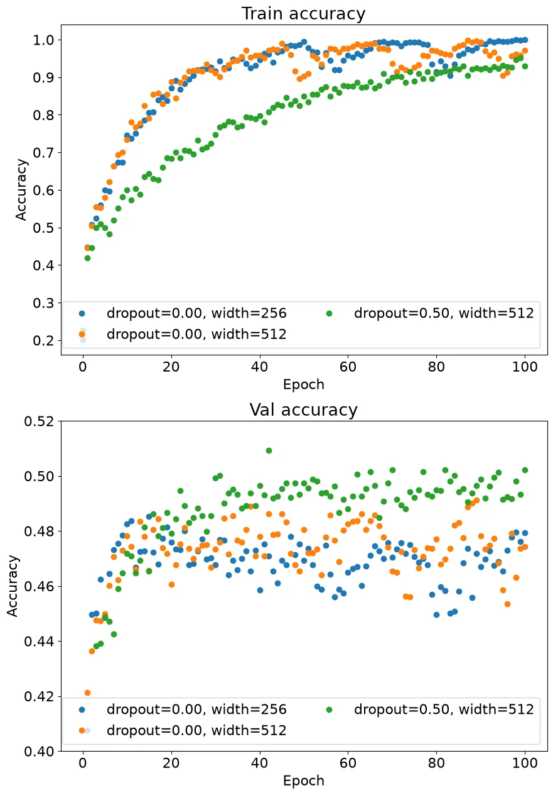

# Assignment 3：Fully-Connected Neural Network & Convolutional Neural Network

A3 include 2 questions:

**Q1: Fully-Connected Neural Network**. Walk you through implementing Fully-Connected Neural Networks.

**Q2: Convolutional Neural Network**. Walk you through implementing Convolutional Neural Networks.

---

## Fully-Connected Neural Network

对双层神经网络进行拓展，采用多个非线性层，最后一层为线性层。



本次实验中，非线性层的激活函数使用ReLU。大体结构为`input-(Linear-ReLU)-(Linear-ReLU)···-Linear-output`。

### Modularization

由于多层神经网络的层数、每层维度、权重等参数都是自定义的，如果像双层神经网络那样逐层进行前向/反向传播，会非常繁琐。为了简化神经网络的训练，我们利用模块化(modularization)来对相同结构进行封装，在模块内部实现相应的前向/反向传播，在需要的时候调用对应的模块。

#### Linear

实现线性层的封装。

**forward pass**

对传入的`x`（形状为（N,d1,d2,...,dk））进行结构调整，并实现线性层的前向计算。`cache`用来记录输入的原始数据，后续反向传播时需要使用。

```py linenums="1"
def forward(x, w, b):
        out = None

        x_flat=x.reshape(x.shape[0],-1)
        out=torch.mm(x_flat,w)+b

        cache = (x, w, b)
        return out, cache
```

**backward pass**

复用`cache`中的数据，实现线性层的反向传播过程，其中`dx`与初始的`x`形状相同。

```py linenums="1"
def backward(dout, cache):
        x, w, b = cache
        dx, dw, db = None, None, None

        x_flat=x.reshape(x.shape[0],-1)
        dx=torch.mm(dout,w.t()).reshape(x.shape)
        dw=torch.mm(x_flat.t(),dout)
        db=dout.sum(dim=0)

        return dx, dw, db
```

#### ReLU

实现`ReLU`的封装。

**forward pass**

实现`ReLU`的前向传播。

```py linenums="1" title="v0" hl_lines="5 6"
def forward(x):
        out = None

        mask=(x<0)
        out=x
        out[mask]=0

        cache = x
        return out, cache
```

这样写犯了一个逻辑错误。在`python`中，把一个变量赋值给新的变量只是将新变量指向原变量，并没有创建一个与原变量值相同的新变量，因此高亮行对`out`进行修改时，同时修改了`x`，导致`cache`中数据错误。

```py linenums="1" title="v1"
out=x*1
out[mask]=0
```

将`out`表示为关于`x`的运算表达式，解释器就会自动创建新变量。

**backward pass**

实现`ReLU`的反向传播，将小于 0 的项的梯度截断为 0。

```py linenums="1"
def backward(dout, cache):
        dx, x = None, cache

        mask=(x<=0)
        grad_x=torch.ones(x.shape,device=x.device,dtype=x.dtype)
        grad_x[mask]=0
        dx=grad_x*dout

        return dx
```

#### Linear_ReLU

由于`Linear+ReLU`的组合在多层神经网络中反复出现，我们可以把这两个模块也封装起来。

```py linenums="1"
class Linear_ReLU(object):

    @staticmethod
    def forward(x, w, b):
        a, fc_cache = Linear.forward(x, w, b)
        out, relu_cache = ReLU.forward(a)
        cache = (fc_cache, relu_cache)
        return out, cache

    @staticmethod
    def backward(dout, cache):
        fc_cache, relu_cache = cache
        da = ReLU.backward(dout, relu_cache)
        dx, dw, db = Linear.backward(da, fc_cache)
        return dx, dw, db
```

#### Loss Function

对损失函数`SVM`和`Softmax`也可以按一样的道理进行封装。

### Utilization

有了封装，我们就可以连接、组合这些模块来实现多层神经网络。默认使用`SGD`进行优化。

#### TwoLayerNet

我们首先通过模块化实现此前已实现过的双层神经网络。

**initialization**

???+ tip "权重初始化"

    对于初始的权重矩阵，我们有一定的要求。如果仅使用按高斯分布生成的随机权重值，原始数据经过多层神经网络的传播，其标准差会被放大/缩小。

    

    上图展示了一个激活函数为`tanh`的六层神经网络，可以看到数据逐步趋于全0。

    那么该如何解决这个问题呢？通过一些数学推导（见下），研究者发现如果给初始权重矩阵选择合适的标准差，就可以让该网络层的输出和输入数据的标准差相近，使各层数据分布变稳定。

    例如，初始权重矩阵的标准差取 $1/\sqrt{D_{in}}$ 时（$D_{in}$是输入矩阵`x`的维度），数据分布就变得很好：

    

    需要注意的是，对于不同的激活函数，初始权重需要满足的标准差也不同。$1/\sqrt{D_{in}}$ 这个结论是基于单个线性层推导出来的。例如，如果激活函数为`ReLU`，初始权重的标准差需要取 $\sqrt{2 / D_{\rm in}}$ 。

??? note "初始标准差推导"

    假设初始权重矩阵的均值为 0，输入矩阵的维度为 $D_{in}$，我们对线性层进行分析：

    $$\begin{aligned}
    \mathbf{y} &= W\mathbf{x} \\[8pt]
    y_i &= \sum_{j=1}^{D_{\mathrm{in}}} x_j w_j \\[12pt]
    \operatorname{Var}(y_i)
    &= D_{\mathrm{in}} \cdot \operatorname{Var}(x_i w_i)
    \\[6pt]
    &= D_{\mathrm{in}} \cdot
    \left(
    \mathbb{E}[x_i^2]\mathbb{E}[w_i^2]
    -\mathbb{E}[x_i]^2\mathbb{E}[w_i]^2
    \right)
    \\[6pt]
    &= D_{\mathrm{in}} \cdot
    \operatorname{Var}(x_i)\operatorname{Var}(w_i)
    \\[12pt]
    \text{If } \operatorname{Var}(w_i)
    &= \frac{1}{D_{\mathrm{in}}},
    \quad \text{then } \operatorname{Var}(y_i)
    = \operatorname{Var}(x_i)
    \end{aligned}$$

本次实验中，初始标准差`weight_scale`是给定的，我们只需要在标准正态分布基础上乘`weight_scale`就能得到均值为 0 、标准差为`weight_scale`的正态分布。偏置初始值直接置 0 。

```py linenums="1"
w1=torch.randn(input_dim,hidden_dim,dtype=dtype,device=device)*(weight_scale)
b1=torch.zeros(hidden_dim,device=device,dtype=dtype)
w2=torch.randn(hidden_dim,num_classes,dtype=dtype,device=device)*(weight_scale)
b2=torch.zeros(num_classes,device=device,dtype=dtype)
self.params['W1']=w1
self.params['b1']=b1
self.params['W2']=w2
self.params['b2']=b2
```

**forward pass**

实例化一个`Linear_ReLU`模块和一个`Linear`模块，调用封装好的前向函数，并将原始数据存入`cache`。

不要忘了正则化项！

- 计算分数

```py linenums="1" title="score"
layer1=Linear_ReLU()
layer2=Linear()
out1,cache1=layer1.forward(X,self.params['W1'],self.params['b1'])
out2,cache2=layer2.forward(out1,self.params['W2'],self.params['b2'])
scores=out2
```

- 调用`Softmax`模块，计算`loss`并记录`softmax`的梯度。

```py linenums="1" title="softmax loss"
loss,grad_softmax=softmax_loss(scores,y)
loss+=self.reg*((self.params['W1']**2).sum()+(self.params['W2']**2).sum())
```

**backward pass**

调用几个模块的反向函数，计算各参数的梯度，并把梯度存入`grad`字典里。

```py linenums="1" title="gradient"
dout1,dw2,db2=layer2.backward(grad_softmax,cache2)
dw2+=2*self.reg*self.params['W2']
dx,dw1,db1=layer1.backward(dout1,cache1)
dw1+=2*self.reg*self.params['W1']
grads['W1']=dw1
grads['b1']=db1
grads['W2']=dw2
grads['b2']=db2
```

#### FullyConnectedNet

与双层神经网络不同的是，在实际实现中我们需要维护几个数据列表来存储/调用不同网络层的模块/`cache`/输入输出，除此之外都是一样的。

**initialization**

```py linenums="1"
last_dim=input_dim
for i in range(self.num_layers-1):
    w=torch.randn(last_dim,hidden_dims[i],device=device,dtype=dtype)*weight_scale
    last_dim=hidden_dims[i]
    b=torch.zeros(hidden_dims[i],device=device,dtype=dtype)
    self.params[f'W{i+1}']=w
    self.params[f'b{i+1}']=b
self.params[f'W{self.num_layers}']=torch.randn(last_dim,num_classes,device=device,dtype=dtype)*weight_scale
self.params[f'b{self.num_layers}']=torch.zeros(num_classes,device=device,dtype=dtype)
```

**forward pass**

```py linenums="1" title="score"
layers=[]
caches=[]
outs=[]
outs.append(X)
for i in range(self.num_layers-1):
    layer=Linear_ReLU()
    layers.append(layer)
    out,cache=layer.forward(outs[i],self.params[f'W{i+1}'],self.params[f'b{i+1}'])
    outs.append(out)
    caches.append(cache)
layer=Linear()
layers.append(layer)
scores,cache=layer.forward(outs[self.num_layers-1],self.params[f'W{self.num_layers}'],self.params[f'b{self.num_layers}'])
outs.append(scores)
caches.append(cache)
```

题目要求在多层神经网络中，正则化系数要多乘一个`0.5`，损失函数和梯度的计算都要相应调整。

```py linenums="1" title="loss"
loss,grad_softmax=softmax_loss(scores,y)
for i in range(self.num_layers):
    loss+=0.5*self.reg*((self.params[f'W{i+1}']**2).sum())
```

**backward pass**

```py linenums="1" title="gradient"
dout,dw,db=layers[self.num_layers-1].backward(grad_softmax,caches[self.num_layers-1])
dw+=self.reg*self.params[f'W{self.num_layers}']
grads[f'W{self.num_layers}']=dw
grads[f'b{self.num_layers}']=db
for i in range(self.num_layers-1):
    index=self.num_layers-2-i
    dout,dw,db=layers[index].backward(dout,caches[index])
    dw+=self.reg*self.params[f'W{index+1}']
    grads[f'W{index+1}']=dw
    grads[f'b{index+1}']=db
```

### Optimization

在优化神经网络的过程中，除了最基本的`SGD`，还有多种梯度下降的方法，下面依次实现几种有代表性的更新规则。

#### SGD Momentum

考虑一个物理场景——物体从山坡上滑下，我们发现对参数张量做梯度下降可以类比到这个物理情景中。初始化随机参数等价于将物体放在山坡上某个位置，初速度为 0 ；而整个梯度下降的过程就等价于让物体沿山坡滑下。

对于山坡上的物体，其重力势能为 $U = m g h$，运动过程中，其受力大小为 $F = - \nabla U$，对应优化过程中的梯度矩阵。而根据牛顿第二定律 $F = m a$，物体速度的变化快慢与力的大小成比例。回忆速度变化公式 $v = v_0 - a \Delta t$，把单位时间与梯度优化的每一步对应起来，可以在梯度下降的公式中引入“速度”。

$$v = \mu v - \alpha \mathbf{d} x$$

$$x = x + v$$

其中 $\mu$ 对应物理情景中摩擦力的影响。

实际代码如下：

```py linenums="1" title="sgd_momentum"
v=config['momentum']*v-config['learning_rate']*dw
next_w=w+v
```

#### RMSprop

使用一个`cache`存储过去的梯度信息，并引入衰减因子来控制`cache`的大小，更新`x`时根据`cache`的大小对这一步的梯度进行缩放。`eps`可以避免分母为 0 /趋于 0 。

```
cache = decay_rate * cache + (1 - decay_rate) * dx^2
x += - learning_rate * dx / (sqrt(cache) + eps)
```

实际代码如下：

```py linenums="1" title="rmsprop"
config['cache']=config['decay_rate']*config['cache']+(1-config['decay_rate'])*(dw**2)
next_w=w-config['learning_rate']*dw/(config['cache']**0.5+config['epsilon'])
```

#### Adam

综合`SGD Momentum`和`RMSprop`，使用两个变量`m`和`v`分别存储过去的梯度和梯度平方的信息，各自都有一个衰减因子。然后，根据更新步数`t`对`m`和`v`进行校正（`m`和`v`从零开始，初始若干步可能很小，导致计算误差）。最后更新时，对“速度”`m`按`v`进行缩放。`eps`防止分母为 0 。

```
m = beta1*m + (1-beta1)*dx
mt = m / (1-beta1^t)
v = beta2*v + (1-beta2)*(dx^2)
vt = v / (1-beta2^t)
x += - learning_rate * m / (np.sqrt(v) + eps)
```

实际代码如下：

```py linenums="1" title="adam"
config['t']+=1
config['m']=config['beta1']*config['m']+(1-config['beta1'])*dw
mt=config['m']/(1-config['beta1']**config['t'])
config['v']=config['beta2']*config['v']+(1-config['beta2'])*(dw**2)
vt=config['v']/(1-config['beta2']**config['t'])
next_w=w-config['learning_rate']*mt/(vt**0.5+config['epsilon'])
```

#### Comparison

对比这几种更新规则，使用五层神经网络，在迭代次数相同的情况下，它们的`loss`下降速度和模型在训练集/验证集上的准确率都各有不同。综合来看，`Adam`算法在这里是最优的。



### Regularization

除了此前一直使用的`L2`正则化，这里介绍一种新的正则化方式——`Dropout`。在训练过程中，对于每层神经网络，我们按一定概率略去输出矩阵的某些项，将其置为 0 ，然后再进入下一层神经网络。这样，我们就忽略了某些权重对损失和梯度的贡献，从而减少训练集的过拟合。

在训练过程中，经过`dropout`层，数据的期望会变为 $p x + (1-p) \cdot 0 = p x$（其中 p 是数据**留存**的概率）。然而，在测试过程中，数据并没有经过`dropout`，依然为 $x$ 。因此，同样的输入，最终的测试结果就可能与训练结果不同！这就需要我们在测试过程中，让数据每经过一层网络都乘 $p$ 。这会加大测试的开销，而我们一般都希望测试结果出来的越快越好，那么如何避免这一操作呢？

解决方法就是在训练过程中，每经过一层神经网络和`dropout`，都对留存的数据除以 $p$ ，期望重新变回 $x$ ，与测试中的数据期望相同。这就是`inversed dropout`。

#### Dropout

我们对`Dropout`层进行封装，实现它的前向和反向过程。

需要注意的是，在实验中， $p$ 代表数据**丢失**的概率，相当于上面的 $1-p$ ，相应的`dropout`操作也要进行调整。

**forward pass**

分成两个模式，训练模式下对数据按概率`p`进行丢弃，测试模式下不进行操作。具体实现是通过生成一个在 0-1 间服从均匀分布的随机矩阵，与`p`比大小，找到需要丢弃的位置。另外，记得把`dropout`的概率/模式及发生`dropout`的索引等原始信息存入`cache`。

```py linenums="1"
def forward(x, dropout_param):
        p, mode = dropout_param['p'], dropout_param['mode']
        if 'seed' in dropout_param:
            torch.manual_seed(dropout_param['seed'])

        mask = None
        out = None

        if mode == 'train':
            mask=(torch.rand(x.shape,device=x.device,dtype=x.dtype)>p)/(1-p)
            out=mask*x

        elif mode == 'test':
            out=x

        cache = (dropout_param, mask)

        return out, cache
```

**backward pass**

实现`dropout`的反向过程。

```py linenums="1"
def backward(dout, cache):

        dropout_param, mask = cache
        mode = dropout_param['mode']

        dx = None
        if mode == 'train':
            dx=dout*mask

        elif mode == 'test':
            dx = dout
        return dx
```

#### Final Network

把`Dropout`的判断及操作融入之前`Fully-Connected Network`的结构中，如果要进行`Dropout`，在训练过程中就要在每个非线性层后（ReLU后）加入一个`Dropout`层，调整原函数中的前向和反向过程。

除了加入`Dropout`，我还删除了原先存储各网络层模块实例化的列表，因为这个神经网络只有`Linear_ReLU`和`Linear`这两种网络层，只要分别实例化一个模块，就可以重复利用。

**forward pass**

```py linenums="1" title="forward pass with dropout" hl_lines="11-13"
layer=Linear_ReLU()
layer_last=Linear()
caches=[]
outs=[]
dropout_layer=Dropout()
dropout_caches=[]
outs.append(X)
for i in range(self.num_layers-1):
    out,cache=layer.forward(outs[i],self.params[f'W{i+1}'],self.params[f'b{i+1}'])

    if self.use_dropout:
        out,dropout_cache=dropout_layer.forward(out,self.dropout_param)
        dropout_caches.append(dropout_cache)
    
    outs.append(out)
    caches.append(cache)
scores,cache=layer_last.forward(outs[self.num_layers-1],self.params[f'W{self.num_layers}'],self.params[f'b{self.num_layers}'])
outs.append(scores)
caches.append(cache)
```

**backward pass**

```py linenums="1" title="backward pass with dropout" hl_lines="11-12"
loss,grad_softmax=softmax_loss(scores,y)
for i in range(self.num_layers):
    loss+=0.5*self.reg*((self.params[f'W{i+1}']**2).sum())
dout,dw,db=layer_last.backward(grad_softmax,caches[self.num_layers-1])
dw+=self.reg*self.params[f'W{self.num_layers}']
grads[f'W{self.num_layers}']=dw
grads[f'b{self.num_layers}']=db
for i in range(self.num_layers-1):
    index=self.num_layers-2-i

    if self.use_dropout:
        dout=dropout_layer.backward(dout,dropout_caches[index])
    
    dout,dw,db=layer.backward(dout,caches[index])
    dw+=self.reg*self.params[f'W{index+1}']
    grads[f'W{index+1}']=dw
    grads[f'b{index+1}']=db
```

#### Test

对一个二层神经网络进行测试，使用不同的隐藏层维度和`dropout`。



比较它们准确率的差异，我们观察到隐藏维为`512`时，有`dropout`的模型在验证集上的准确率高于没有`dropout`的模型，并且比隐藏维为`256`的模型在验证集上的准确率高。这说明`dropout`确实发挥了作用，即便隐藏维很大，通过设置适当的`dropout`，我们也可以很好地避免训练集上的过拟合。