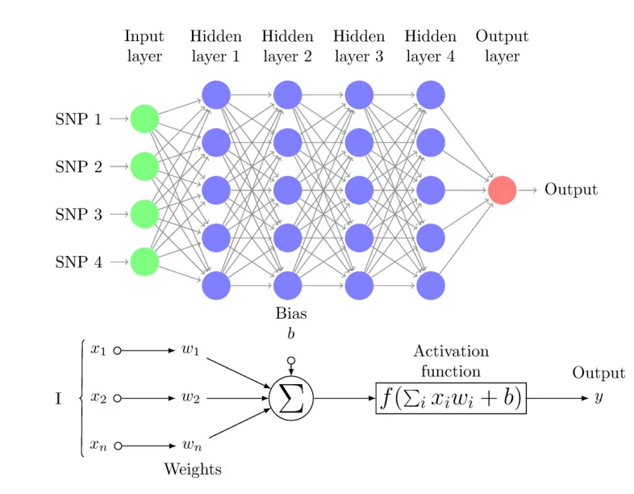
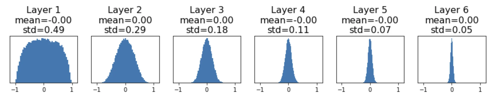
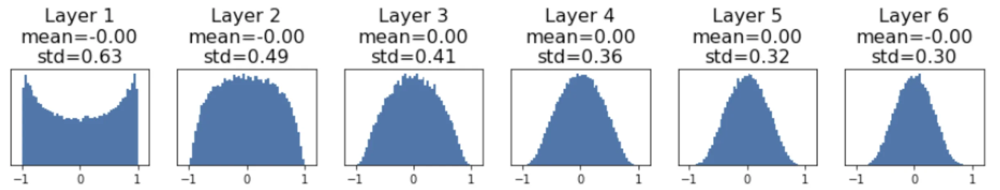
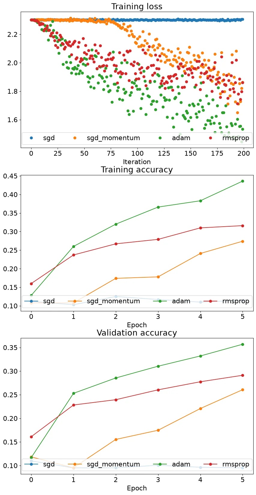
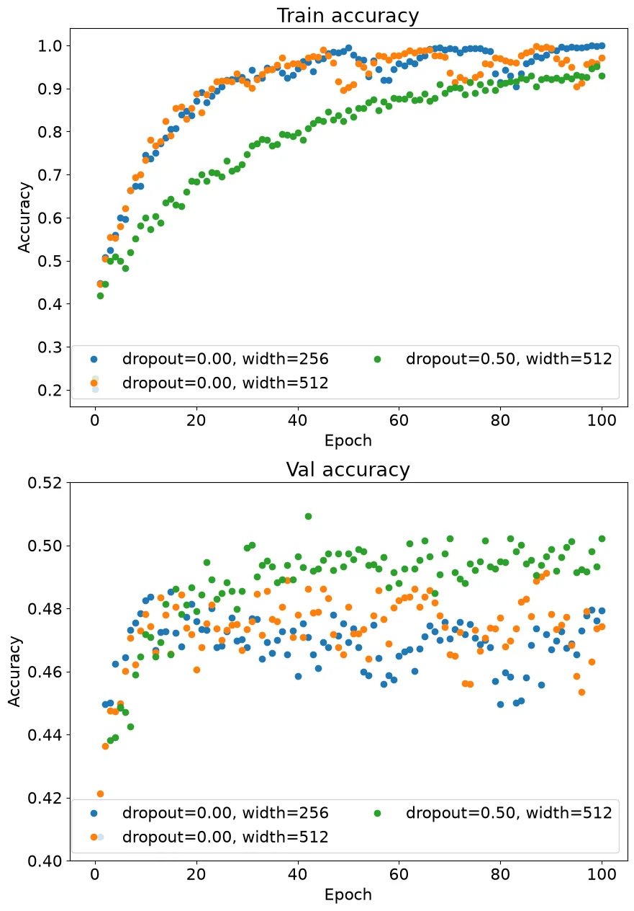
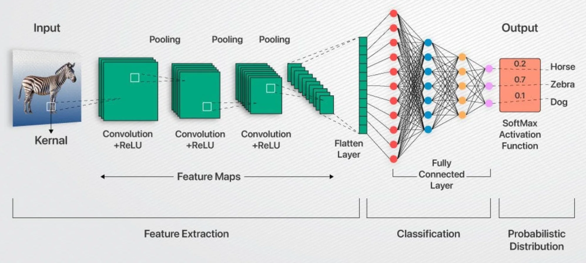
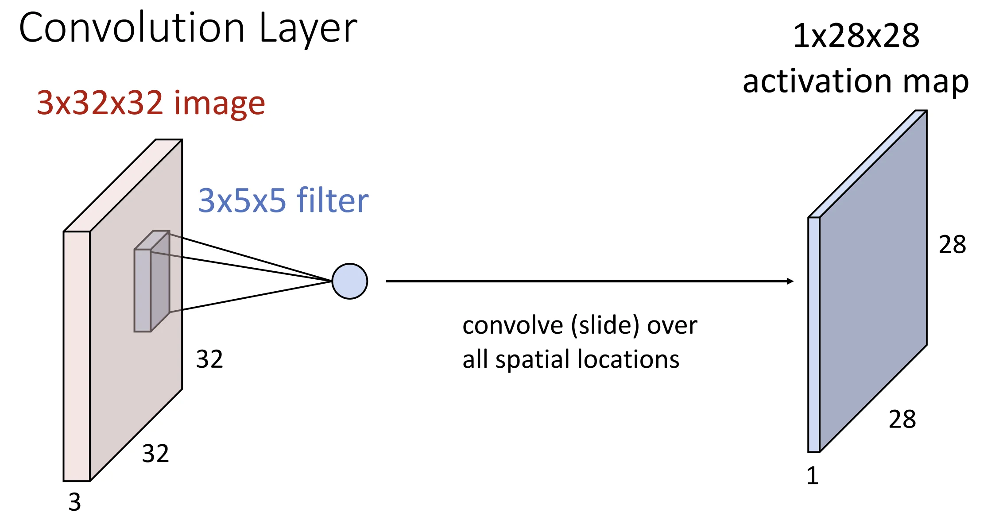
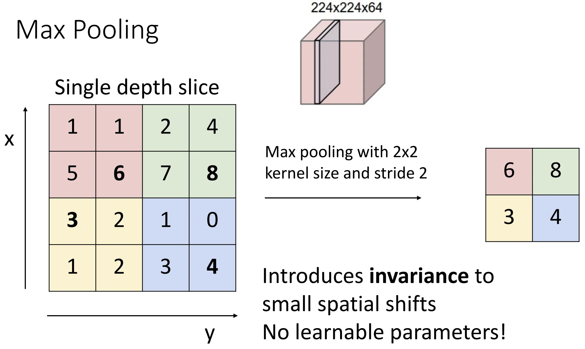

# Assignment 3：Fully-Connected Neural Network & Convolutional Neural Network

A3 include 2 questions:

**Q1: Fully-Connected Neural Network**. Walk you through implementing Fully-Connected Neural Networks.

**Q2: Convolutional Neural Network**. Walk you through implementing Convolutional Neural Networks.

---

## Fully-Connected Neural Network

对双层神经网络进行拓展，采用多个非线性层，最后一层为线性层。



本次实验中，非线性层的激活函数使用ReLU。大体结构为`input-(Linear-ReLU)-(Linear-ReLU)···-Linear-output`。

### Modularization

由于多层神经网络的层数、每层维度、权重等参数都是自定义的，如果像双层神经网络那样逐层进行前向/反向传播，会非常繁琐。为了简化神经网络的训练，我们利用模块化(modularization)来对相同结构进行封装，在模块内部实现相应的前向/反向传播，在需要的时候调用对应的模块。

#### Linear

实现线性层的封装。

**forward pass**

对传入的`x`（形状为（N,d1,d2,...,dk））进行结构调整，并实现线性层的前向计算。`cache`用来记录输入的原始数据，后续反向传播时需要使用。

```py linenums="1"
def forward(x, w, b):
        out = None

        x_flat=x.reshape(x.shape[0],-1)
        out=torch.mm(x_flat,w)+b

        cache = (x, w, b)
        return out, cache
```

**backward pass**

复用`cache`中的数据，实现线性层的反向传播过程，其中`dx`与初始的`x`形状相同。

```py linenums="1"
def backward(dout, cache):
        x, w, b = cache
        dx, dw, db = None, None, None

        x_flat=x.reshape(x.shape[0],-1)
        dx=torch.mm(dout,w.t()).reshape(x.shape)
        dw=torch.mm(x_flat.t(),dout)
        db=dout.sum(dim=0)

        return dx, dw, db
```

#### ReLU

实现`ReLU`的封装。

**forward pass**

实现`ReLU`的前向传播。

```py linenums="1" title="v0" hl_lines="5 6"
def forward(x):
        out = None

        mask=(x<0)
        out=x
        out[mask]=0

        cache = x
        return out, cache
```

这样写犯了一个逻辑错误。在`python`中，把一个变量赋值给新的变量只是将新变量指向原变量，并没有创建一个与原变量值相同的新变量，因此高亮行对`out`进行修改时，同时修改了`x`，导致`cache`中数据错误。

```py linenums="1" title="v1"
out=x*1
out[mask]=0
```

将`out`表示为关于`x`的运算表达式，解释器就会自动创建新变量。

**backward pass**

实现`ReLU`的反向传播，将小于 0 的项的梯度截断为 0。

```py linenums="1"
def backward(dout, cache):
        dx, x = None, cache

        mask=(x<=0)
        grad_x=torch.ones(x.shape,device=x.device,dtype=x.dtype)
        grad_x[mask]=0
        dx=grad_x*dout

        return dx
```

#### Linear_ReLU

由于`Linear+ReLU`的组合在多层神经网络中反复出现，我们可以把这两个模块也封装起来。

```py linenums="1"
class Linear_ReLU(object):

    @staticmethod
    def forward(x, w, b):
        a, fc_cache = Linear.forward(x, w, b)
        out, relu_cache = ReLU.forward(a)
        cache = (fc_cache, relu_cache)
        return out, cache

    @staticmethod
    def backward(dout, cache):
        fc_cache, relu_cache = cache
        da = ReLU.backward(dout, relu_cache)
        dx, dw, db = Linear.backward(da, fc_cache)
        return dx, dw, db
```

#### Loss Function

对损失函数`SVM`和`Softmax`也可以按一样的道理进行封装。

### Utilization

有了封装，我们就可以连接、组合这些模块来实现多层神经网络。默认使用`SGD`进行优化。

#### TwoLayerNet

我们首先通过模块化实现此前已实现过的双层神经网络。

**initialization**

???+ tip "权重初始化"

    对于初始的权重矩阵，我们有一定的要求。如果仅使用按高斯分布生成的随机权重值，原始数据经过多层神经网络的传播，其标准差会被放大/缩小。

    

    上图展示了一个激活函数为`tanh`的六层神经网络，可以看到数据逐步趋于全0。

    那么该如何解决这个问题呢？通过一些数学推导（见下），研究者发现如果给初始权重矩阵选择合适的标准差，就可以让该网络层的输出和输入数据的标准差相近，使各层数据分布变稳定。

    例如，初始权重矩阵的标准差取 $1/\sqrt{D_{in}}$ 时（$D_{in}$是输入矩阵`x`的维度），数据分布就变得很好：

    

    需要注意的是，对于不同的激活函数，初始权重需要满足的标准差也不同。$1/\sqrt{D_{in}}$ 这个结论是基于单个线性层推导出来的。例如，如果激活函数为`ReLU`，初始权重的标准差需要取 $\sqrt{2 / D_{\rm in}}$ 。

??? note "初始标准差推导"

    假设初始权重矩阵的均值为 0，输入矩阵的维度为 $D_{in}$，我们对线性层进行分析：

    $$\begin{aligned}
    \mathbf{y} &= W\mathbf{x} \\[8pt]
    y_i &= \sum_{j=1}^{D_{\mathrm{in}}} x_j w_j \\[12pt]
    \operatorname{Var}(y_i)
    &= D_{\mathrm{in}} \cdot \operatorname{Var}(x_i w_i)
    \\[6pt]
    &= D_{\mathrm{in}} \cdot
    \left(
    \mathbb{E}[x_i^2]\mathbb{E}[w_i^2]
    -\mathbb{E}[x_i]^2\mathbb{E}[w_i]^2
    \right)
    \\[6pt]
    &= D_{\mathrm{in}} \cdot
    \operatorname{Var}(x_i)\operatorname{Var}(w_i)
    \\[12pt]
    \text{If } \operatorname{Var}(w_i)
    &= \frac{1}{D_{\mathrm{in}}},
    \quad \text{then } \operatorname{Var}(y_i)
    = \operatorname{Var}(x_i)
    \end{aligned}$$

本次实验中，初始标准差`weight_scale`是给定的，我们只需要在标准正态分布基础上乘`weight_scale`就能得到均值为 0 、标准差为`weight_scale`的正态分布。偏置初始值直接置 0 。

```py linenums="1"
w1=torch.randn(input_dim,hidden_dim,dtype=dtype,device=device)*(weight_scale)
b1=torch.zeros(hidden_dim,device=device,dtype=dtype)
w2=torch.randn(hidden_dim,num_classes,dtype=dtype,device=device)*(weight_scale)
b2=torch.zeros(num_classes,device=device,dtype=dtype)
self.params['W1']=w1
self.params['b1']=b1
self.params['W2']=w2
self.params['b2']=b2
```

**forward pass**

实例化一个`Linear_ReLU`模块和一个`Linear`模块，调用封装好的前向函数，并将原始数据存入`cache`。

不要忘了正则化项！

- 计算分数

```py linenums="1" title="score"
layer1=Linear_ReLU()
layer2=Linear()
out1,cache1=layer1.forward(X,self.params['W1'],self.params['b1'])
out2,cache2=layer2.forward(out1,self.params['W2'],self.params['b2'])
scores=out2
```

- 调用`Softmax`模块，计算`loss`并记录`softmax`的梯度。

```py linenums="1" title="softmax loss"
loss,grad_softmax=softmax_loss(scores,y)
loss+=self.reg*((self.params['W1']**2).sum()+(self.params['W2']**2).sum())
```

**backward pass**

调用几个模块的反向函数，计算各参数的梯度，并把梯度存入`grad`字典里。

```py linenums="1" title="gradient"
dout1,dw2,db2=layer2.backward(grad_softmax,cache2)
dw2+=2*self.reg*self.params['W2']
dx,dw1,db1=layer1.backward(dout1,cache1)
dw1+=2*self.reg*self.params['W1']
grads['W1']=dw1
grads['b1']=db1
grads['W2']=dw2
grads['b2']=db2
```

#### FullyConnectedNet

与双层神经网络不同的是，在实际实现中我们需要维护几个数据列表来存储/调用不同网络层的模块/`cache`/输入输出，除此之外都是一样的。

**initialization**

```py linenums="1"
last_dim=input_dim
for i in range(self.num_layers-1):
    w=torch.randn(last_dim,hidden_dims[i],device=device,dtype=dtype)*weight_scale
    last_dim=hidden_dims[i]
    b=torch.zeros(hidden_dims[i],device=device,dtype=dtype)
    self.params[f'W{i+1}']=w
    self.params[f'b{i+1}']=b
self.params[f'W{self.num_layers}']=torch.randn(last_dim,num_classes,device=device,dtype=dtype)*weight_scale
self.params[f'b{self.num_layers}']=torch.zeros(num_classes,device=device,dtype=dtype)
```

**forward pass**

```py linenums="1" title="score"
layers=[]
caches=[]
outs=[]
outs.append(X)
for i in range(self.num_layers-1):
    layer=Linear_ReLU()
    layers.append(layer)
    out,cache=layer.forward(outs[i],self.params[f'W{i+1}'],self.params[f'b{i+1}'])
    outs.append(out)
    caches.append(cache)
layer=Linear()
layers.append(layer)
scores,cache=layer.forward(outs[self.num_layers-1],self.params[f'W{self.num_layers}'],self.params[f'b{self.num_layers}'])
outs.append(scores)
caches.append(cache)
```

题目要求在多层神经网络中，正则化系数要多乘一个`0.5`，损失函数和梯度的计算都要相应调整。

```py linenums="1" title="loss"
loss,grad_softmax=softmax_loss(scores,y)
for i in range(self.num_layers):
    loss+=0.5*self.reg*((self.params[f'W{i+1}']**2).sum())
```

**backward pass**

```py linenums="1" title="gradient"
dout,dw,db=layers[self.num_layers-1].backward(grad_softmax,caches[self.num_layers-1])
dw+=self.reg*self.params[f'W{self.num_layers}']
grads[f'W{self.num_layers}']=dw
grads[f'b{self.num_layers}']=db
for i in range(self.num_layers-1):
    index=self.num_layers-2-i
    dout,dw,db=layers[index].backward(dout,caches[index])
    dw+=self.reg*self.params[f'W{index+1}']
    grads[f'W{index+1}']=dw
    grads[f'b{index+1}']=db
```

### Optimization

在优化神经网络的过程中，除了最基本的`SGD`，还有多种梯度下降的方法，下面依次实现几种有代表性的更新规则。

#### SGD Momentum

考虑一个物理场景——物体从山坡上滑下，我们发现对参数张量做梯度下降可以类比到这个物理情景中。初始化随机参数等价于将物体放在山坡上某个位置，初速度为 0 ；而整个梯度下降的过程就等价于让物体沿山坡滑下。

对于山坡上的物体，其重力势能为 $U = m g h$，运动过程中，其受力大小为 $F = - \nabla U$，对应优化过程中的梯度矩阵。而根据牛顿第二定律 $F = m a$，物体速度的变化快慢与力的大小成比例。回忆速度变化公式 $v = v_0 - a \Delta t$，把单位时间与梯度优化的每一步对应起来，可以在梯度下降的公式中引入“速度”。

$$v = \mu v - \alpha \mathbf{d} x$$

$$x = x + v$$

其中 $\mu$ 对应物理情景中摩擦力的影响。

实际代码如下：

```py linenums="1" title="sgd_momentum"
v=config['momentum']*v-config['learning_rate']*dw
next_w=w+v
```

#### RMSprop

使用一个`cache`存储过去的梯度信息，并引入衰减因子来控制`cache`的大小，更新`x`时根据`cache`的大小对这一步的梯度进行缩放。`eps`可以避免分母为 0 /趋于 0 。

```
cache = decay_rate * cache + (1 - decay_rate) * dx^2
x += - learning_rate * dx / (sqrt(cache) + eps)
```

实际代码如下：

```py linenums="1" title="rmsprop"
config['cache']=config['decay_rate']*config['cache']+(1-config['decay_rate'])*(dw**2)
next_w=w-config['learning_rate']*dw/(config['cache']**0.5+config['epsilon'])
```

#### Adam

综合`SGD Momentum`和`RMSprop`，使用两个变量`m`和`v`分别存储过去的梯度和梯度平方的信息，各自都有一个衰减因子。然后，根据更新步数`t`对`m`和`v`进行校正（`m`和`v`从零开始，初始若干步可能很小，导致计算误差）。最后更新时，对“速度”`m`按`v`进行缩放。`eps`防止分母为 0 。

```
m = beta1*m + (1-beta1)*dx
mt = m / (1-beta1^t)
v = beta2*v + (1-beta2)*(dx^2)
vt = v / (1-beta2^t)
x += - learning_rate * m / (np.sqrt(v) + eps)
```

实际代码如下：

```py linenums="1" title="adam"
config['t']+=1
config['m']=config['beta1']*config['m']+(1-config['beta1'])*dw
mt=config['m']/(1-config['beta1']**config['t'])
config['v']=config['beta2']*config['v']+(1-config['beta2'])*(dw**2)
vt=config['v']/(1-config['beta2']**config['t'])
next_w=w-config['learning_rate']*mt/(vt**0.5+config['epsilon'])
```

#### Comparison

对比这几种更新规则，使用五层神经网络，在迭代次数相同的情况下，它们的`loss`下降速度和模型在训练集/验证集上的准确率都各有不同。综合来看，`Adam`算法在这里是最优的。



### Regularization

除了此前一直使用的`L2`正则化，这里介绍一种新的正则化方式——`Dropout`。在训练过程中，对于每层神经网络，我们按一定概率略去输出矩阵的某些项，将其置为 0 ，然后再进入下一层神经网络。这样，我们就忽略了某些权重对损失和梯度的贡献，从而减少训练集的过拟合。

在训练过程中，经过`dropout`层，数据的期望会变为 $p x + (1-p) \cdot 0 = p x$（其中 p 是数据**留存**的概率）。然而，在测试过程中，数据并没有经过`dropout`，依然为 $x$ 。因此，同样的输入，最终的测试结果就可能与训练结果不同！这就需要我们在测试过程中，让数据每经过一层网络都乘 $p$ 。这会加大测试的开销，而我们一般都希望测试结果出来的越快越好，那么如何避免这一操作呢？

解决方法就是在训练过程中，每经过一层神经网络和`dropout`，都对留存的数据除以 $p$ ，期望重新变回 $x$ ，与测试中的数据期望相同。这就是`inversed dropout`。

#### Dropout

我们对`Dropout`层进行封装，实现它的前向和反向过程。

需要注意的是，在实验中， $p$ 代表数据**丢失**的概率，相当于上面的 $1-p$ ，相应的`dropout`操作也要进行调整。

**forward pass**

分成两个模式，训练模式下对数据按概率`p`进行丢弃，测试模式下不进行操作。具体实现是通过生成一个在 0-1 间服从均匀分布的随机矩阵，与`p`比大小，找到需要丢弃的位置。另外，记得把`dropout`的概率/模式及发生`dropout`的索引等原始信息存入`cache`。

```py linenums="1"
def forward(x, dropout_param):
        p, mode = dropout_param['p'], dropout_param['mode']
        if 'seed' in dropout_param:
            torch.manual_seed(dropout_param['seed'])

        mask = None
        out = None

        if mode == 'train':
            mask=(torch.rand(x.shape,device=x.device,dtype=x.dtype)>p)/(1-p)
            out=mask*x

        elif mode == 'test':
            out=x

        cache = (dropout_param, mask)

        return out, cache
```

**backward pass**

实现`dropout`的反向过程。

```py linenums="1"
def backward(dout, cache):

        dropout_param, mask = cache
        mode = dropout_param['mode']

        dx = None
        if mode == 'train':
            dx=dout*mask

        elif mode == 'test':
            dx = dout
        return dx
```

#### Final Network

把`Dropout`的判断及操作融入之前`Fully-Connected Network`的结构中，如果要进行`Dropout`，在训练过程中就要在每个非线性层后（ReLU后）加入一个`Dropout`层，调整原函数中的前向和反向过程。

除了加入`Dropout`，我还删除了原先存储各网络层模块实例化的列表，因为这个神经网络只有`Linear_ReLU`和`Linear`这两种网络层，只要分别实例化一个模块，就可以重复利用。

**forward pass**

```py linenums="1" title="forward pass with dropout" hl_lines="11-13"
layer=Linear_ReLU()
layer_last=Linear()
caches=[]
outs=[]
dropout_layer=Dropout()
dropout_caches=[]
outs.append(X)
for i in range(self.num_layers-1):
    out,cache=layer.forward(outs[i],self.params[f'W{i+1}'],self.params[f'b{i+1}'])

    if self.use_dropout:
        out,dropout_cache=dropout_layer.forward(out,self.dropout_param)
        dropout_caches.append(dropout_cache)
    
    outs.append(out)
    caches.append(cache)
scores,cache=layer_last.forward(outs[self.num_layers-1],self.params[f'W{self.num_layers}'],self.params[f'b{self.num_layers}'])
outs.append(scores)
caches.append(cache)
```

**backward pass**

```py linenums="1" title="backward pass with dropout" hl_lines="11-12"
loss,grad_softmax=softmax_loss(scores,y)
for i in range(self.num_layers):
    loss+=0.5*self.reg*((self.params[f'W{i+1}']**2).sum())
dout,dw,db=layer_last.backward(grad_softmax,caches[self.num_layers-1])
dw+=self.reg*self.params[f'W{self.num_layers}']
grads[f'W{self.num_layers}']=dw
grads[f'b{self.num_layers}']=db
for i in range(self.num_layers-1):
    index=self.num_layers-2-i

    if self.use_dropout:
        dout=dropout_layer.backward(dout,dropout_caches[index])
    
    dout,dw,db=layer.backward(dout,caches[index])
    dw+=self.reg*self.params[f'W{index+1}']
    grads[f'W{index+1}']=dw
    grads[f'b{index+1}']=db
```

#### Test

对一个二层神经网络进行测试，使用不同的隐藏层维度和`dropout`。



比较它们准确率的差异，我们观察到隐藏维为`512`时，有`dropout`的模型在验证集上的准确率高于没有`dropout`的模型，并且比隐藏维为`256`的模型在验证集上的准确率高。这说明`dropout`确实发挥了作用，即便隐藏维很大，通过设置适当的`dropout`，我们也可以很好地避免训练集上的过拟合。

## Convolutional Neural Network

卷积神经网络（CNN）是一种不同的神经网络架构，它在卷积层设置一系列 **kernal** 。当数据经过卷积层时，让每个 **kernal** 像一个小窗口，从左到右、从上到下滑过整个数据张量，让 **kernal** 的权重与对应窗口的数据做卷积（对应相乘再相加），产生一个标量输出，这些输出构成一个新的张量，进入下一个卷积层。卷积层可以叠加，影响某个最终输出的初始输入数据的范围称为“感受野”（reception field）。



在卷积层之间仍然会采用 `ReLU` 等激活函数来非线性化，同时 CNN 还会采用 `pool` 层来压缩数据规模、扩大感受野。在经过多层卷积层后，数据最后通过一个全连接层（fully-connected-layer）/线性层来计算各个类别的得分，由于是线性层，所以我们需要预先把多维的输入张量展平为一维向量。

### Convolution Layer

实现单个卷积层前向和反向的封装。

???+ tip "卷积层"
    
    
    一个卷积层存储了多个卷积核，每个卷积核也可被称作一个 **filter**。每个卷积核都是一个三维张量，其中一个维度对应输入的`channel`数，另外两个维度是滑过输入张量的窗口尺寸（如上图）。

    将所有卷积核滑过输入张量、计算卷积后，依旧输出一个三维张量，这个张量的 `channel` 变为 `filter` 数，另两个维度要根据原张量大小、窗口大小和窗口的步长来计算。

    👉 实际操作时，还会引入一个 `padding` 的概念，将输入张量从边缘向外再扩展若干行/列，其数据一般置为 0 。这是为了增加边缘数据对输出的影响，因为如果不加 `padding` ，四个角落的数据各自只对一个输出有贡献，模型难以学习到这部分信息。

**forward pass**

- API：设输入张量尺寸为（C×H×W），共 N 个；卷积核尺寸为（C×HH×WW），共 F 个；在 H 和 W `padding`的参数由`conv_param['pad]`给出。 

```py title="v0" linenums="1" hl_lines="12-16"
x_pad=torch.nn.functional.pad(x,(conv_param['pad'],conv_param['pad'],conv_param['pad'],conv_param['pad']),"constant",0)
H=x_pad.shape[2]
W=x_pad.shape[3]
C=x_pad.shape[1]
N=x_pad.shape[0]
HH=w.shape[2]
WW=w.shape[3]
F=w.shape[0]
H_out=1+(H-HH)//conv_param['stride']
W_out=1+(W-WW)//conv_param['stride']
out=torch.zeros(N,F,H_out,W_out,device=x.device,dtype=x.dtype)
for j in range(W):
    for i in range(H):
        out[:,:,i,j]=(x_pad[:,:,i:i+HH,j:j+WW].reshape(N,1,C,HH,WW)*w.reshape(1,F,C,HH,WW)).sum(dim=(2,3,4))
        i+=conv_param['stride']
    j+=conv_param['stride']
out+=b.reshape(1,F,1,1)
```

如果直接用循环来写，整体思路是比较清晰的，就是把卷积核从左到右从上到下遍历输入张量，在内层循环中计算相应的卷积，赋值到输出张量的对应位置。

不过，我这里有个语法问题：我在 15-16 行希望在循环末尾显式地按照步长更新窗口的坐标，然而`python`每次循环开始时都会按照`range`的规则给`i`/`j`赋值，这两行就完全无效，窗口没有正确地按步长移动。此外还有个逻辑问题：我的`i`和`j`取的都是原张量的索引，并不是输出张量的索引。

解决方法是：以输出张量的索引作为循环参数，利用其与`stride`的乘积来计算窗口对应到输入张量的坐标。

```py title="v1" linenums="1" 
for j in range(W_out):
    col=j*conv_param['stride']
    for i in range(H_out):
        row=i*conv_param['stride']
        out[:,:,i,j]=(x_pad[:,:,row:row+HH,col:col+WW].reshape(N,1,C,HH,WW)*w.reshape(1,F,C,HH,WW)).sum(dim=(2,3,4))
```

这是改写后的双层循环。

**backward pass**

```py linenums="1"
x=cache[0]
w=cache[1]
b=cache[2]
conv_param=cache[3]
x_pad=torch.nn.functional.pad(x,(conv_param['pad'],conv_param['pad'],conv_param['pad'],conv_param['pad']),"constant",0)
H_out=dout.shape[2]
W_out=dout.shape[3]
N=x.shape[0]
C=x.shape[1]
H=x_pad.shape[2]
W=x_pad.shape[3]
F=w.shape[0]
HH=w.shape[2]
WW=w.shape[3]
dx_pad=torch.zeros_like(x_pad)
dx=torch.zeros_like(x)
dw=torch.zeros_like(w)
db=torch.zeros_like(b)
db=dout.sum(dim=(0,2,3))
for j in range(W_out):
    col=j*conv_param['stride']
    for i in range(H_out):
        row=i*conv_param['stride']
        dx_pad[:,:,row:row+HH,col:col+WW]+=(dout[:,:,i,j].reshape(N,F,1,1,1)*w.reshape(1,F,C,HH,WW)).sum(dim=1)
        dw+=(dout[:,:,i,j].reshape(N,F,1,1,1)*x_pad[:,:,row:row+HH,col:col+WW].reshape(N,1,C,HH,WW)).sum(dim=0)
dx=dx_pad[:,:,conv_param['pad']:H-conv_param['pad'],conv_param['pad']:W-conv_param['pad']]
```

和前向一样，写一个双层循环，模拟窗口的滑动，同时计算梯度。这里只涉及到乘加，只要对齐索引，梯度还是比较好求的。针对`padding`的存在，我选择先计算`padding`后张量的梯度，再根据`padding`参数剪裁张量，得到原张量的梯度。

### Pooling Layer

我们只在输入张量的 H 和 W 两个维度做 `pooling` 操作。和卷积层类似，它也是使用窗口+步长来滑过整个输入张量，每个窗口输出一个元素。不同的是，这个元素不需要通过可学习参数来得到，而是通过取最大值、取平均等规则得到，所以`pooling`不需要权重，开销极小。另外，`pooling` 会保留 C （`channel`） 这个维度。

???+ tip "Max Pooling"

    

    本实验中，我们选取`Max`作为`pooling`的规则，每次仅在窗口内选取最大值保留到输出。

**forward pass**

实现池化层的前向传播。

```py title="forward pass" linenums="1"
N=x.shape[0]
C=x.shape[1]
H=x.shape[2]
W=x.shape[3]
HH=pool_param['pool_height']
WW=pool_param['pool_width']
stride=pool_param['stride']
H_out=1+(H-HH)//stride
W_out=1+(W-WW)//stride
out=torch.zeros(N,C,H_out,W_out,device=x.device,dtype=x.dtype)
for j in range(W_out):
    col=j*stride
    for i in range(H_out):
        row=i*stride
        out[:,:,i,j]=torch.max(x[:,:,row:row+HH,col:col+WW].reshape(N,C,-1),dim=2)[0]
```

按照上述规则，用一个双层循环即可。循环索引沿用卷积层的策略。

**backward pass**

实现池化层的反向传播。

```py title="v0" linenums="1" hl_lines="16-18"
x=cache[0]
pool_param=cache[1]
N=x.shape[0]
C=x.shape[1]
HH=pool_param['pool_height']
WW=pool_param['pool_width']
stride=pool_param['stride']
H_out=dout.shape[2]
W_out=dout.shape[3]
dx=torch.zeros_like(x)
for j in range(W_out):
    col=j*stride
    for i in range(H_out):
        row=i*stride
        idx=torch.argmax(x[:,:,row:row+HH,col:col+WW].reshape(N,C,-1),dim=2)
        idx1=(idx+1)//WW
        idx2=idx-(idx1+1)*WW
        dx[:,:,row+idx1,col+idx2]+=dout[:,:,i,j]
```

和卷积层类似，重现窗口滑过张量的过程，同时计算梯度。高亮的几行是我希望找到最大值对应的原张量索引进而进行梯度的累加，为了在 15 行使用`argmax`，我将原张量的 H 和 W 两个维度合并，在新维度上获取最大值坐标，之后再在16-17行进行坐标复原。然而这里有个语法问题，`argmax`返回的实际上是一个形如（N，C）的索引矩阵，给出了每组N、C维度的坐标对应的最大值索引。而 18 行切片索引需要每个维度的索引张量具有相同的形状。

此外，16-17行的索引复原也存在一些问题。改正后代码如下。

```py title="v1" linenums="1" hl_lines="4-6"
idx=torch.argmax(x[:,:,row:row+HH,col:col+WW].reshape(N,C,-1),dim=2)
idx1=idx//WW
idx2=idx%WW
for n in range(N):
    for c in range(C):
        dx[n,c,idx1[n,c],idx2[n,c]]+=dout[n,c,i,j]
```

由于`idx`是展平后的索引矩阵，我们需要通过除以列数（WW）和模列数来复原合并前两个维度的索引。注意这个索引是窗口内的相对索引，而不是绝对索引，还需加上当前窗口在原张量的横纵坐标。而后，高亮行采用了一个二重循环来对应每组 N 和 C 的坐标。

但实际上这里有个更加简洁的做法，只需要在切片索引时，让每个维度的坐标都是一个形如（N，C）的索引矩阵即可，索引会依序对应到梯度矩阵的位置。

```py title="v2" linenums="1"
idx1=idx//WW+row
idx2=idx%WW+col
dx[torch.arange(N).reshape(N,1),torch.arange(C).reshape(1,C),idx1,idx2]+=dout[:,:,i,j]
```

### Three-Layer Convolutional Network

接下来我们组装各模块，实现一个三层的卷积神经网络。其基本结构是：`conv - relu - 2x2 max pool - linear - relu - linear - softmax`。

**initialization**

初始化权重和偏置，和此前的 MLP 一样，初始权重遵循以`weight_scale`为标准差、以 0 为期望的正态分布。

```py linenums="1"
W1=torch.randn((num_filters,input_dims[0],filter_size,filter_size),dtype=dtype,device=device)*weight_scale
b1=torch.zeros((num_filters,),dtype=dtype,device=device)
W2=torch.randn((num_filters*(input_dims[1]//2)*(input_dims[2]//2),hidden_dim),device=device,dtype=dtype)*weight_scale
b2=torch.zeros((hidden_dim,),dtype=dtype,device=device)
W3=torch.randn((hidden_dim,num_classes),dtype=dtype,device=device)*weight_scale
b3=torch.zeros((num_classes,),dtype=dtype,device=device)
self.params['W1']=W1
self.params['b1']=b1
self.params['W2']=W2
self.params['b2']=b2
self.params['W3']=W3
self.params['b3']=b3
```

- 这里假设卷积层使用的`padding`和步长`stride`组合导致输出张量的 H 和 W 维度正好与原张量的 H 和 W 维相同。
- 经过 2 × 2 的 `pooling` 层后，张量的 H 和 W 维的尺寸会变为原先的一半。
- 最后的两层全连接层前，张量会被展平，因此第一个全连接层的输入维度大小 $C_{in}$ 要通过计算原张量除 N 外的各维度大小乘积得到。

**forward pass**

接下来实现整个网络的前向部分，计算得分。

```py linenums="1"
CRP=Conv_ReLU_Pool()
LR=Linear_ReLU()
L=Linear()
out1,cache1=CRP.forward(X,W1,b1,conv_param,pool_param)

out2,cache2=LR.forward(out1,W2,b2)
scores,cache3=L.forward(out2,W3,b3)
```

调用此前实现的卷积层和全连接层模块即可。

**backward pass**

实现网络的反向部分，计算损失和梯度。

```py linenums="1"
loss,grad_scores=softmax_loss(scores,y)
loss+=self.reg*((W1*W1).sum()+(W2*W2).sum()+(W3*W3).sum())
grad_out2,grad_W3,grad_b3=L.backward(grad_scores,cache3)
grad_W3+=2*self.reg*W3
grad_out1,grad_W2,grad_b2=LR.backward(grad_out2,cache2)
grad_W2+=2*self.reg*W2
grad_X,grad_W1,grad_b1=CRP.backward(grad_out1,cache1)
grad_W1+=2*self.reg*W1
grads['W1']=grad_W1
grads['b1']=grad_b1
grads['W2']=grad_W2
grads['b2']=grad_b2
grads['W3']=grad_W3
grads['b3']=grad_b3
```

同样地，直接调用模块就比较简单。

### Deep Convolutional Network

接下来，我们要实现一个更深层的卷积神经网络，将多个卷积层（+池化层）串联起来，最后经过一个线性层，可自定义层数和池化层的位置。其结构是：`{conv - [batchnorm?] - relu - [pool?]} x (L - 1) - linear`。算上线性层共 L 层。

这里我们采取 `VGG` 网络的架构，将卷积层的`kernal_size`均视为 3 × 3 。

**initialization**

进行权重和偏置的初始化，相比三层的 CNN ，需要使用循环。

```py linenums="1"
last_fil=input_dims[0]
H=input_dims[1]
W=input_dims[2]
for i in range(self.num_layers-1):
    self.params[f'W{i+1}']=torch.randn(num_filters[i],last_fil,3,3,dtype=dtype,device=device)*weight_scale
    self.params[f'b{i+1}']=torch.zeros(num_filters[i],dtype=dtype,device=device)
    last_fil=num_filters[i]
for i in range(len(max_pools)):
    H=H//2
    W=W//2
self.params[f'W{self.num_layers}']=torch.randn(last_fil*H*W,num_classes,dtype=dtype,device=device)*weight_scale
self.params[f'b{self.num_layers}']=torch.zeros(num_classes,dtype=dtype,device=device)
```

由于池化层的位置是不确定的，所以还需要一个循环遍历所有池化层来正确计算最终的张量尺寸。

**forward pass**

```py linenums="1"
CR=Conv_ReLU()
CRP=Conv_ReLU_Pool()
L=Linear()
cache=[]
input=X
for i in range(self.num_layers-1):
    W=self.params[f'W{i+1}']
    b=self.params[f'b{i+1}']
    if i in self.max_pools:
        out,c=CRP.forward(input,W,b,conv_param,pool_param)
    else:
        out,c=CR.forward(input,W,b,conv_param)
    input=out
    cache.append(c)
W=self.params[f'W{self.num_layers}']
b=self.params[f'b{self.num_layers}']
scores,c=L.forward(input,W,b)
cache.append(c)
```

**backward pass**

```py linenums="1"
loss,grad_score=softmax_loss(scores,y)
for i in range(self.num_layers):
    W=self.params[f'W{i+1}']
    loss+=self.reg*(W*W).sum()
grad_linear,grads[f'W{self.num_layers}'],grads[f'b{self.num_layers}']=L.backward(grad_score,cache[self.num_layers-1])
grads[f'W{self.num_layers}']+=2*self.reg*self.params[f'W{self.num_layers}']
last_grad=grad_linear
for i in range(self.num_layers-2,-1,-1):
    c=cache[i]
    if i in self.max_pools:
        last_grad,grads[f'W{i+1}'],grads[f'b{i+1}']=CRP.backward(last_grad,c)
    else:
        last_grad,grads[f'W{i+1}'],grads[f'b{i+1}']=CR.backward(last_grad,c)
    grads[f'W{i+1}']+=2*self.reg*self.params[f'W{i+1}']
```

### Kaiming Initialization

我们还记得，初始权重的方差/标准差会影响数据在训练过程中的分布变化。为了使输入数据和输出数据的方差相等，权重需要满足某种特定的分布。然而，由于不同的层在数据上进行的操作有所不同，其所需要的合适的初始权重也不同。例如，有`ReLU`和没有`ReLU`的全连接层对权重的要求不同，卷积层和全连接层对权重的要求也不同。如果所有权重初始化都是用一个统一的`weight_scale`参数，就无法满足这些多样化的需求。因此，我们需要采取“凯明初始化”（Kaiming Initialization）。

本网络涉及到四种情况，下面直接给出对应的权重分布，略去推导（利用了方差的一些性质）。

- Linear + ReLU：$W_{ij}\sim\mathcal{N}\left(0,\frac{2}{D_{in}}\right)$
- Linear：$W_{ij}\sim\mathcal{N}\left(0,\frac{1}{D_{in}}\right)$
- Convolution + ReLU（卷积核大小为 K）：$W_{o,i,u,v}\sim\mathcal{N}\left(0,\frac{2}{D_{in}K^2}\right)$
- Convolution：$W_{o,i,u,v}\sim\mathcal{N}\left(0,\frac{1}{D_{in}K^2}\right)$

```py title="kaiming initializer" linenums="1"
    gain = 2. if relu else 1.
    weight = None
    if K is None:
        if relu:
            weight=torch.randn(Din,Dout,dtype=dtype,device=device)*(2/Din)**0.5
        else:
            weight=torch.randn(Din,Dout,dtype=dtype,device=device)*(1/Din)**0.5
    else:
        fan_in=Din*K*K
        if relu:
            weight=torch.randn(Dout,Din,K,K,dtype=dtype,device=device)*(2/fan_in)**0.5
        else:
            weight=torch.randn(Dout,Din,K,K,dtype=dtype,device=device)*(1/fan_in)**0.5
```

注意：代码中的 $D_{in}$ 在卷积层中指卷积核尺寸 $K$ ，在线性层中指`channel`数；$K$只在线性层给出，是卷积核尺寸。因此，线性层的输入维度需要通过 $D_{in} \times K \times K$ 计算得到。

相应地，在前面写的深层神经网络的优化部分加一个`kaiming`初始化的分支，调用这个`kaiming initializer`函数。

```py title="initialization with kaiming initializer" linenums="1" hl_lines="5-8 14-17"
last_fil=input_dims[0]
H=input_dims[1]
W=input_dims[2]
for i in range(self.num_layers-1):
    if weight_scale == "kaiming":
        self.params[f'W{i+1}']=kaiming_initializer(last_fil,num_filters[i],3,True,device,dtype)
    else:
        self.params[f'W{i+1}']=torch.randn(num_filters[i],last_fil,3,3,dtype=dtype,device=device)*weight_scale
    self.params[f'b{i+1}']=torch.zeros(num_filters[i],dtype=dtype,device=device)
    last_fil=num_filters[i]
for i in range(len(max_pools)):
    H=H//2
    W=W//2
if weight_scale == "kaiming":
    self.params[f'W{self.num_layers}']=kaiming_initializer(last_fil*H*W,num_classes,None,False,device,dtype)
else:
    self.params[f'W{self.num_layers}']=torch.randn(last_fil*H*W,num_classes,dtype=dtype,device=device)*weight_scale
self.params[f'b{self.num_layers}']=torch.zeros(num_classes,dtype=dtype,device=device)
```

### Training & Testing

接下来，我们就可以利用这个深层神经网络，自定义超参数，训练一个模型。

经过反复调参 + 让 AI 评估收益较大的调参方向，我最终设置的模型参数如下。

```py title="create_convolutional_solver_instance" linenums="1"
num_train=40000
data = {
    'X_train': data_dict['X_train'][:num_train],
    'y_train': data_dict['y_train'][:num_train],
    'X_val': data_dict['X_val'],
    'y_val': data_dict['y_val'],
}
model = DeepConvNet(input_dims=data_dict['X_train'].shape[1:], num_classes=10,
    num_filters=([32]*1+[64]*2+[128]*1),
    max_pools=[1,2],
    weight_scale="kaiming",
    reg=1e-3,
    dtype=dtype,
    device=device
)
solver = Solver(model,data,
                num_epochs=5, batch_size=128,
                update_rule=adam,
                optim_config={
                'learning_rate': 1.5e-3,
                },
                lr_decay=0.9,
                print_every=30, device=device)
```

**结果**

它在验证集上的准确率是 `0.7421000003814697`，约`74.2%`；在测试集上的准确率是`0.7368999719619751`，约`73.7%`。

???+ note "一些经验"

    最开始的时候，我设置了一个几十层的神经网络，学习率也很高，为 0.1。使用 10000 章图片进行训练，这个模型的表现很差。大幅压缩层数、减小学习率后有了显著提升，但仍未达到`70%`以上。这时的限制因素主要是训练样本不足，扩展到所有 40000 张图片后就达到了标准。

    在此基础上，我又微调了层数、每层的`filter_size`和池化层位置，训练出最好的这个模型，这里面有一些大概的经验之谈（不保证通用性，仅基于我这次调参）：

    - 层数不宜过深，4-5层就够了
    - 每层的 `filter_size` 只要在一个大致的范围内就影响不大，具体可能有轻微差异。
    - 池化层最好在网络偏中心的几层，放在边缘没有放在中间表现好。池化层数量不宜超过总层数的一半。